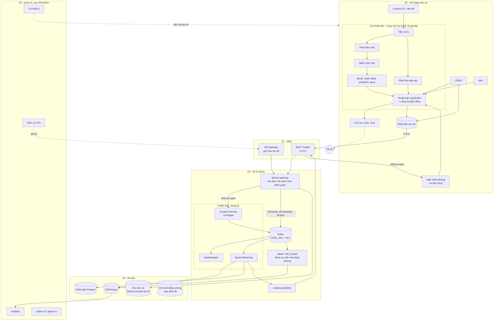

# 2. Kiến trúc tổng thể

> Các thành phần bảo mật trong sơ đồ (mTLS, ACL, API gateway, CA, OTA ký) là thiết kế đích và được làm **sau cùng** (P6, file 7). Giai đoạn đầu chạy trong mạng LAN tin cậy, không mã hóa.

## 2.1 Năm ý tưởng thiết kế chính

1. **Ba tầng với ranh giới rõ.**
   - *Tầng thiết bị* (DF-Edge): quyết định cảnh báo, hoàn toàn cục bộ.
   - *Tầng cổng và sự kiện* (DF-Cloud): xác thực, nhận tin, lưu sự kiện, báo cáo.
   - *Tầng giao thông* (Traffic-SM): nhận GPS ẩn danh, map matching, tắc nghẽn. Dùng nguyên các thành phần hiện có.
2. **Cảnh báo là việc của thiết bị, phân tích là việc của đám mây.** Đám mây không bao giờ nằm trên đường găng của một tiếng còi.
3. **Hai luồng đi lên, một luồng đi xuống.**
   - Lên (1): GPS 1 Hz, đúng định dạng ingest của Traffic-SM, mã `driver_id` là mã chuyến ẩn danh.
   - Lên (2): sự kiện cảnh báo, heartbeat, tóm tắt chuyến, vào Kafka của DriveFocus.
   - Xuống: ngữ cảnh đường qua MQTT, có thời hạn hiệu lực ngắn, không bắt buộc.
4. **Kafka vẫn là trục trung tâm ở đám mây**, theo đúng mô hình đã chạy tốt ở Traffic-SM: mỗi stage đọc một topic, ghi một topic, có dead-letter.
5. **Giả lập bằng cách thay lớp phần cứng, không thay thuật toán.** Lõi thuật toán chỉ nói chuyện với giao diện `CameraSource`, `GpsSource`, `Actuator`, `Uplink`. K230 và bản giả lập là hai bản cài đặt của cùng giao diện.

## 2.2 Sơ đồ khối

## 2.3 Phân chia trách nhiệm

| Việc | Ở đâu | Vì sao |
|---|---|---|
| Phát hiện mắt/miệng/đầu/hành vi | Thiết bị | Độ trễ, riêng tư (video không rời xe), hoạt động khi mất mạng |
| Quyết định mức cảnh báo | Thiết bị | Như trên; đám mây chỉ cấp tham số và ngữ cảnh |
| Cổng chuyển động | Thiết bị | Cần tức thời; dùng GPS/IMU cục bộ |
| Hàng đợi khi mất mạng | Thiết bị | Không mất sự kiện, gửi bù |
| Xác thực thiết bị, ẩn danh hóa mã | device-gateway | Chỉ một nơi biết ánh xạ thiết bị ↔ chuyến |
| Map matching, tắc nghẽn | Traffic-SM | Đã có, đã đo |
| Khớp sự kiện vào đoạn đường, bản đồ rủi ro | Spark `risk_stream` | Cần dữ liệu `gps.matched` của mọi xe, quy mô lớn |
| Điểm lái an toàn theo tài xế | DF-Cloud (vùng hạn chế) | Dữ liệu cá nhân, cần phân quyền chặt |
| Ngữ cảnh đường cho thiết bị | context-publisher | Biến kết quả Traffic-SM thành tin nhỏ cho từng chuyến |

## 2.4 Vì sao Traffic-SM không chỉ "kiểm tra một xe"

Traffic-SM được thiết kế cho **nhiều xe cùng lúc**: tốc độ chuẩn của một đoạn đường được học từ phân vị 85 của mọi xe đi qua, và mức tắc nghẽn là trung vị tốc độ nhiều xe so với chuẩn đó. Một chiếc xe đơn lẻ không cho biết đường có tắc hay không, nhưng khi mỗi thiết bị DriveFocus gửi GPS vào cùng pipeline, **cả đội xe trở thành mạng cảm biến (probe) cho Traffic-SM**, và ngược lại Traffic-SM cho mỗi thiết bị biết mình đang ở đoạn đường như thế nào so với số đông. Đây là giá trị cộng hưởng của việc ghép hai hệ thống, chi tiết ở file 6.

## 2.5 Ba vòng thời gian

| Vòng | Độ trễ | Ví dụ |
|---|---|---|
| Vòng phản xạ (trên thiết bị) | mili giây đến vài giây | Nhắm mắt → còi |
| Vòng giao thông (Traffic-SM) | khoảng 10 đến 60 giây | GPS → mức tắc → ngữ cảnh gửi lại thiết bị |
| Vòng học (batch) | giờ đến ngày | Điểm nóng rủi ro theo đoạn × giờ; tinh chỉnh ngưỡng; huấn luyện lại mô hình |

## 2.6 Chế độ suy giảm có kiểm soát

| Mất gì | Thiết bị làm gì |
|---|---|
| Mạng di động | Cảnh báo cục bộ nguyên vẹn; sự kiện và GPS vào hàng đợi, gửi bù khi có mạng |
| Đám mây / Traffic-SM | Như trên; ngữ cảnh đường hết hạn thì dùng ngưỡng mặc định |
| GPS (hầm, đô thị cao tầng) | Giữ trạng thái chuyển động tối đa 30 giây, sau đó dùng IMU; cả hai mất thì chỉ giữ mức 4 theo hướng an toàn (xem file 4) |
| Camera bị che/không thấy mặt | Cảnh báo mức 2 "không thấy tài xế" sau 5 giây khi xe chạy; không suy diễn về mắt |
| Thiết bị quá nóng/quá tải | Hạ tốc độ khung hình của bộ phát hiện bàn tay và hướng nhìn trước, giữ bộ đo mắt; báo qua heartbeat |
