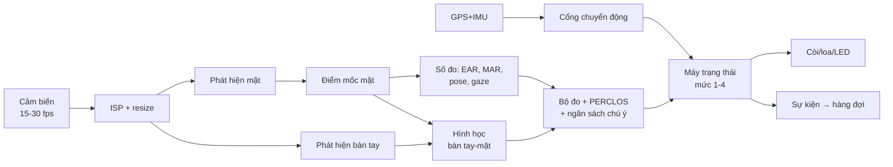
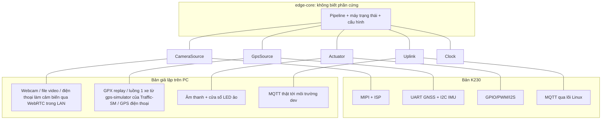

# 3. Thiết bị biên K230 và bản giả lập

## 3.1 Chip K230: những gì đã xác nhận

Nguồn: [K230 Product Brief](https://www.kendryte.com/k230/en/dev/K230_brief_datasheet.html) và trang [sản phẩm Kendryte](https://www.kendryte.com/en/products) (đối chiếu ngày 09/11/2026).

| Hạng mục | Thông số |
|---|---|
| CPU | 2 lõi RISC-V 64-bit: lõi 1,6 GHz có FPU và vector RVV 1.0, chạy RTOS; lõi 800 MHz (RV64GCB) chạy Linux |
| KPU (bộ tăng tốc AI) | INT8 và INT16, nén trọng số thưa. **Khoảng 6 TOPS**: trang sản phẩm chính thức ghi "6T" cho K230 nhưng không nêu đơn vị hay độ chính xác; product brief kỹ thuật không nêu TOPS mà đưa tốc độ mô hình (INT8): ResNet-50 ≥ 85 fps, MobileNetV2 ≥ 670 fps, YOLOv5s ≥ 38 fps |
| Bộ nhớ | DDR3L / LPDDR3 / LPDDR4, tối đa 2 GB; SRAM trên chip 2 MB + 2 MB |
| Camera | 3 cổng MIPI CSI; ISP tổng 8 MP @ 30 fps; 3A, 2D/3D NR, WDR/HDR, LSC, de-warping; **hỗ trợ mẫu RGB-IR 4×4** |
| Mã hóa video | H.264/H.265, JPEG/MJPEG (không cần dùng) |
| Bảo mật phần cứng | PUF, OTP, TRNG; AES, SHA, RSA, SM2/SM3/SM4, ECC. Secure boot và TEE: brief không nêu (chỉ liên quan P6) |
| Giao tiếp | 5 I2C, 5 UART, 6 PWM, 3 SPI, 2 USB 2.0 OTG, 2 SD/eMMC; Ethernet và SDIO: tùy bo |

Ý nghĩa cho thiết kế:
- Dùng con số **6 TOPS** khi trình bày, kèm chú thích "theo nhà sản xuất; hiệu năng thực tế phụ thuộc mô hình và băng thông bộ nhớ". Chỉ số đo thật trên bo của nhóm mới là chỉ số của đồ án.
- Các mô hình thị giác cần dùng (phát hiện mặt, điểm mốc, bàn tay, tư thế) đều có sẵn bản đã biên dịch cho KPU trong SDK, nên không phải tự huấn luyện hay lượng tử hóa cho các tác vụ chính.
- Điểm thắt thực tế thường là tiền/hậu xử lý trên CPU và sao chép bộ nhớ, cần đo.
- Hỗ trợ RGB-IR 4×4 mở đường cho cảm biến ảnh vừa có màu ban ngày vừa có hồng ngoại ban đêm.

## 3.2 Phần cứng đề xuất (bản demo)

Tên linh kiện chỉ là ví dụ để định hình, không phải khuyến nghị mua.

| Khối | Yêu cầu | Ví dụ |
|---|---|---|
| Bo xử lý | K230, ≥ 512 MB RAM, MIPI CSI | CanMV-K230 hoặc bo tương đương; về sau bo tự thiết kế |
| Camera | Nhạy hồng ngoại gần, có thể bỏ lọc IR-cut, FOV đủ bao khuôn mặt ở 50 đến 80 cm | Cảm biến MIPI hỗ trợ bởi SDK |
| Đèn IR | 940 nm (ít chói, ít thấy) điều khiển bằng PWM qua MOSFET; công suất an toàn mắt | Vòng LED IR |
| GNSS | UART, 1 đến 5 Hz, xuất tốc độ và độ chính xác | Module GNSS phổ thông |
| IMU | I2C, 3 trục gia tốc + con quay | MPU-6050 / ICM-42688 hoặc tương đương |
| Mạng | LTE Cat-1 qua USB/UART, hoặc WiFi tether với điện thoại ở giai đoạn đầu | Modem LTE Cat-1 |
| Âm thanh | Loa + khuếch đại, còi ≥ 85 dB trong cabin | Loa nhỏ + buzzer |
| Chỉ báo | LED RGB, tùy chọn motor rung (ghế/vô-lăng) | |
| Nguồn | 9 đến 36 V vào, 5 V ra; chống xung (load dump), sụt áp khi khởi động xe; chân ACC để biết xe nổ máy | Mạch nguồn ô tô |
| Lưu trữ | SD/eMMC cho hàng đợi sự kiện và nhật ký | |
| Đồng hồ | RTC + siêu tụ để giữ giờ khi mất nguồn | |

## 3.3 Phân vai hai lõi và chọn môi trường chạy

K230 có hai lõi khác vai trò. Đề xuất phân vai (cần xác nhận theo SDK đang dùng):

| Lõi | Hệ điều hành | Việc |
|---|---|---|
| 1,6 GHz (vector) | RTOS (RT-Smart) | Vòng suy luận, máy trạng thái, điều khiển còi/LED. Đường găng độ trễ thấp |
| 800 MHz | Linux | Kết nối mạng, MQTT/TLS, hàng đợi sự kiện, OTA, nhật ký |

Nguyên tắc: **tiến trình cảnh báo không được chờ tiến trình mạng.** Hai bên trao đổi qua hàng đợi một chiều, bên mạng chết thì cảnh báo vẫn chạy.

Hai hướng phát triển, theo thứ tự:

1. **Nguyên mẫu nhanh:** MicroPython trên firmware [CanMV-K230](https://github.com/kendryte/k230_canmv), gọi các mô hình `.kmodel` có sẵn. Mục tiêu chỉ là kiểm chứng mô hình và độ trễ trên chip thật.
2. **Bản demo hướng production:** C++ trên [k230_sdk](https://github.com/kendryte/k230_sdk) (cùng lõi thuật toán với bản giả lập, xem 3.6), dịch mô hình bằng [nncase](https://github.com/kendryte/nncase).

Các demo trong SDK ([kendryte/k230_sdk](https://github.com/kendryte/k230_sdk), thư mục `src/reference/ai_poc`) là **nền tảng cho tầng cảm biến** của DriveFocus. Đã xác nhận có: `face_detection`, `face_landmark` (106 điểm), `face_mesh`, `face_pose`, `face_glasses`, `eye_gaze`, `distraction_reminder`, `dms_system` (kèm phát hiện lòng bàn tay). Chi tiết ở [file 11](11-khao-sat-repo-tham-khao.md). Cấu trúc thay đổi theo phiên bản SDK, nên đối chiếu đúng bản đang dùng.

Phần **thuật toán quyết định** (file 4: EAR chuẩn hóa, PERCLOS, ngân sách chú ý, cổng chuyển động, mức cảnh báo) là phần nhóm tự viết, không có trong SDK; các demo `distraction_reminder` và `dms_system` chỉ có luật đơn giản đếm số khung.

## 3.4 Đường ống xử lý trên thiết bị

Khi đã có điểm mốc mặt thì không cần chạy lại bộ phát hiện mặt đầy đủ mỗi khung; có thể suy ra vùng cắt từ khung trước và chỉ phát hiện lại khi mất dấu. Tối ưu này cần đo lợi ích ở P3.

## 3.5 Ngân sách tài nguyên

Tất cả là **ước tính để thiết kế**, đo thật ở P3 và ghi vào bảng đo (mẫu như `dds-edge/reports/summary.md`).

| Mô hình (từ SDK K230) | Vai trò | Tần số |
|---|---|---|
| `face_detection` (RetinaFace, 0.25-MobileNet) | Tìm mặt tài xế | 15 fps hoặc theo dõi |
| `face_landmark` (106 điểm, 0.5-MobileNet) hoặc `face_mesh` | EAR, MAR, tư thế | 15 fps |
| `face_pose` | Tư thế đầu (đối chiếu PnP) | 15 fps |
| Phát hiện lòng bàn tay (YOLOv5, MobileNetV2) | Luật điện thoại/uống/hút thuốc | 5 đến 10 fps |
| `eye_gaze`, `face_glasses` | Hướng nhìn, có kính (tùy chọn) | 5 fps |

Các mô hình trên đều dùng backbone nhẹ (MobileNet, SqueezeNet); benchmark MobileNetV2 ≥ 670 fps của brief cho thấy về lý thuyết nằm gọn trong ngân sách, nhưng số liệu cuối cùng phải đo trên bo.

| Tài nguyên | Mục tiêu |
|---|---|
| RAM | ≤ 50% dung lượng bo |
| Lưu trữ | Hàng đợi ≥ 24 giờ sự kiện + GPS (vài chục MB nếu nén) |
| Nhiệt | Ổn định trong cabin 60 °C; có chiến lược hạ tốc độ khung |
| Điện | Vài watt; cắt nguồn an toàn khi tắt máy |

Băng thông lên (ước tính): GPS 1 điểm/giây JSON khoảng 300 byte, gom lô 10 điểm + gzip còn vài chục KB mỗi phút; sự kiện vài trăm byte. Cỡ vài MB mỗi giờ xe chạy.

## 3.6 Bản giả lập và lớp trừu tượng phần cứng (HAL)

Mục tiêu: chạy toàn bộ luồng trước khi có board.

Quy tắc để không "lệch" giữa giả lập và thiết bị thật:

1. **Lõi thuật toán là hàm thuần của luồng đặc trưng và luồng chuyển động.** Cho cùng chuỗi `(thời gian, EAR, MAR, yaw, pitch, xác suất lớp, tốc độ)` thì cho cùng chuỗi sự kiện.
2. **Bộ vector kiểm thử vàng (golden traces).** Ghi từ phiên giả lập thật rồi dùng làm đầu vào cố định; bản Python tham chiếu và bản C++ trên K230 đều phải tái tạo đúng chuỗi sự kiện. Đây là cách bảo đảm port không đổi hành vi.
3. **Nhập đặc trưng ở mức trừu tượng.** Giai đoạn đầu mô hình mặt chạy ONNX/MediaPipe trên PC; điểm mốc có thể khác chút so với bản KPU. Do đó tập vàng ghi cả **đặc trưng** lẫn **video gốc** để so sánh bản KPU với bản PC, đo sai lệch đặc trưng (không chỉ so sự kiện).
4. **Điện thoại làm cảm biến, không làm thiết bị.** Điện thoại stream camera/GPS tới laptop trong mạng LAN để thử góc nhìn thật; không phát triển ứng dụng điện thoại chạy riêng, tránh phải viết lại thuật toán lần nữa.
5. **Chạy lại từ ghi hình.** Công cụ phát lại video + GPX cho phép chạy hồi quy mỗi khi đổi ngưỡng.
