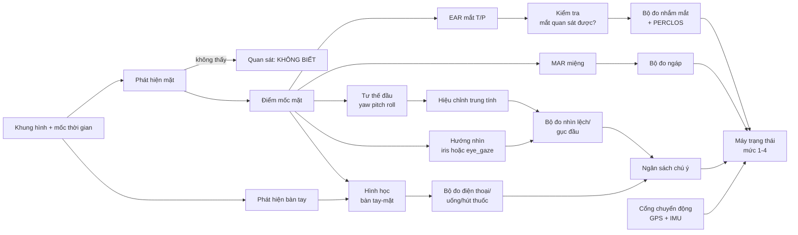
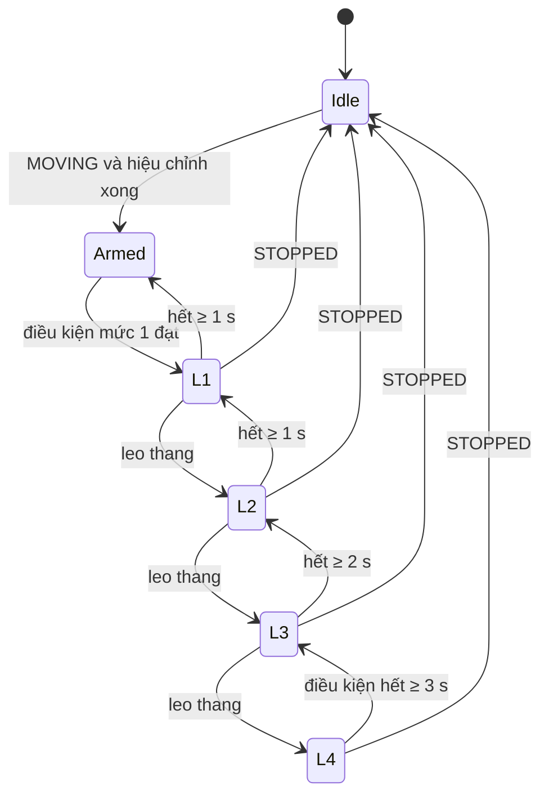

# 4. Thuật toán và mức cảnh báo

Đây là phần lõi của đồ án. Nguyên tắc: **mọi quyết định (nhắm mắt, buồn ngủ, mất tập trung, dùng điện thoại, cảnh báo) do thuật toán tự viết đưa ra**. Mạng nơ-ron chỉ đóng vai "cảm biến" phổ thông (tìm mặt, điểm mốc, bàn tay, tư thế đầu). Không dùng mô hình phân loại hành vi của `dds-edge` cho các quyết định quan trọng.

Thiết kế dựa trên việc đọc mã của các dự án thật (chi tiết và giấy phép ở [file 11](11-khao-sat-repo-tham-khao.md)):

| Ý tưởng lấy từ | Dùng ở đâu |
|---|---|
| [e-candeloro/driver-state-detection](https://github.com/e-candeloro/driver-state-detection) (MIT) | EAR 6 điểm tính theo pixel, quan sát ba trạng thái (đóng / mở / không biết), PERCLOS trượt theo thời gian loại phần "không biết", bộ đếm thời gian có suy giảm, PnP cho tư thế đầu |
| [commaai/openpilot](https://github.com/commaai/openpilot) (MIT), module monitoring | Ngưỡng tốc độ tối thiểu để cảnh báo 10 km/h, "ngân sách chú ý" giảm nhanh và hồi chậm, hiệu chỉnh tư thế trung tính khi xe đang chạy, bỏ qua tín hiệu mắt khi không quan sát được (kính râm), khóa leo thang |
| [kendryte/k230_sdk](https://github.com/kendryte/k230_sdk) demo `dms_system`, `distraction_reminder`, `eye_gaze`, `face_pose` | Chuỗi cảm biến chạy được trên KPU, luật hình học bàn tay–khuôn mặt cho điện thoại/hút thuốc/uống nước, nhắc nhở theo góc tư thế |

## 4.1 Tổng quan đường ống



Hai tầng tách bạch:
- **Tầng cảm biến (mạng nơ-ron phổ thông):** cho ra tọa độ và góc, kèm độ tin cậy. Thay được (MediaPipe trên PC, mô hình K230 trên chip) mà không đụng tầng sau.
- **Tầng quyết định (thuật toán của đồ án):** nhận số đo, trả sự kiện và mức cảnh báo. Là hàm thuần của chuỗi số đo có mốc thời gian, nên kiểm thử và so sánh PC với K230 bằng cùng chuỗi đầu vào.

## 4.2 Tầng cảm biến

| Đại lượng | PC / giả lập | K230 (demo SDK có sẵn) | Ghi chú |
|---|---|---|---|
| Khung mặt + 5 điểm | MediaPipe | `face_detection`: RetinaFace, backbone 0.25-MobileNet | |
| Điểm mốc dày | MediaPipe Face Landmarker, 478 điểm gồm mống mắt | `face_landmark` (106 điểm, backbone 0.5-MobileNet) hoặc `face_mesh` (căn chỉnh 3DDFA) | **Việc phải làm ở P1/P3:** lập bảng ánh xạ 6 điểm mỗi mắt và các điểm môi cho từng bộ điểm mốc, vẽ lên ảnh để kiểm chứng |
| Tư thế đầu | **Ma trận biến đổi mặt của MediaPipe** (mặc định); PnP 6 điểm dùng mô hình mặt chuẩn của MediaPipe làm phương án dự phòng | `face_pose` hoặc PnP | Trên ảnh mẫu nhìn thẳng, ma trận cho pitch +4°, còn PnP 6 điểm cho +18° (nhạy với đặc điểm khuôn mặt từng người). Lệch hằng số bị bước hiệu chỉnh trung tính loại bỏ, nhưng độ nhiễu thì không, nên chọn ma trận |
| Hướng nhìn | Độ lệch mống mắt so với tâm mắt chia chiều rộng mắt | `eye_gaze` | Cho thêm cờ "nhìn lệch" độc lập với đầu |
| Bàn tay | MediaPipe Hands hoặc YOLO nhỏ | Phát hiện lòng bàn tay (YOLOv5 MobileNetV2) trong `dms_system` | |
| Có đeo kính | Heuristic ảnh (4.4.4) | `face_glasses` (SqueezeNet-1.1) | |

Mốc thời gian là **giờ đồng hồ thực của khung hình**, không phải số khung, để kết quả không đổi khi tốc độ khung thay đổi (các demo K230 dùng đếm số khung nên nhạy với fps).

## 4.3 Cổng chuyển động: chỉ khi xe chạy

| Trạng thái | Vào | Ra | Cảnh báo hành vi |
|---|---|---|---|
| `STOPPED` | Tốc độ < 3 km/h liên tục 5 s | Tốc độ ≥ 10 km/h liên tục 3 s | Tắt hết |
| `MOVING` | Tốc độ ≥ 10 km/h liên tục 3 s | Tốc độ < 3 km/h liên tục 5 s | Bật |
| `UNKNOWN` | Mất GPS và IMU không kết luận được | Có lại GPS hoặc IMU kết luận được | Chỉ giữ nhắm mắt mức 4 và gục đầu |

- Ngưỡng 10 km/h trùng với `_ALERT_MIN_SPEED = 2.8  # 10 km/h` trong cấu hình giám sát tài xế của openpilot (chú thích trong mã dẫn tới văn bản EU `OJ:L_202501899`).
- Khoảng cách giữa 3 km/h và 10 km/h cùng thời gian giữ tạo **hysteresis**, tránh nhấp nháy khi kẹt xe.
- Nguồn tốc độ: GPS (xét `speed_acc`) → IMU (phương sai rung động cho biết có chạy, không cho biết tốc độ). Mất GPS thì giữ trạng thái cũ tối đa 30 s.
- Đồ án chạy nhiều ca không có xe thật: bản giả lập đọc tốc độ từ tệp GPX hoặc từ `gps-simulator` của Traffic-SM.

## 4.4 Các bộ đo (estimator)

### 4.4.1 Quan sát ba trạng thái

Mỗi bộ đo nhận giá trị `đóng`, `mở` hoặc `KHÔNG BIẾT` (mặt mất, mắt bị che, độ tin cậy thấp). **`KHÔNG BIẾT` không cộng và không làm suy giảm bộ đếm**, và bị loại khỏi mẫu số của PERCLOS (cách làm của e-candeloro). Nhờ vậy không bao giờ suy ra "mắt nhắm" chỉ vì không nhìn thấy mắt. Trường hợp dễ báo nhầm nhất là bị loại từ thiết kế.

### 4.4.2 Nhắm mắt

**EAR** (Eye Aspect Ratio) từ 6 điểm mỗi mắt, tính **theo pixel** (không dùng tọa độ chuẩn hóa vì làm méo tỉ lệ khung hình):

```
EAR_mắt = ( |p2−p6| + |p3−p5| ) / ( 2 × |p1−p4| )       p1,p4 là hai khóe mắt
EAR     = trung bình hai mắt (bỏ mắt có chiều rộng ≈ 0)
```

Với MediaPipe, e-candeloro dùng chỉ số `[33,133,160,144,158,153]` (mắt thứ nhất) và `[362,263,385,380,387,373]` (mắt thứ hai).

**Chuẩn hóa theo người:** `EAR_norm = EAR / EAR_mở`, với `EAR_mở` là trung vị EAR trong 60 s đầu khi xe chạy ổn định (bỏ khung chớp). Mắt coi là **đóng** khi `EAR_norm < 0,5`. Trước khi hiệu chỉnh xong, dùng ngưỡng tuyệt đối 0,15 (mặc định của e-candeloro). Cả hai số này là khởi điểm, chỉnh bằng dữ liệu ở 4.8.

**Đoạn nhắm liên tục `closure_run`:** thời gian liên tục mắt đóng, **chịu được lỗ hổng ngắn** ≤ 0,2 s (nhiễu điểm mốc một hai khung), vượt thì reset. Đây là đại lượng quyết định cho mức 4.

**PERCLOS trượt:** tỉ lệ thời gian mắt đóng trong 60 s, tích phân theo thời gian giữa các mẫu, bỏ khoảng `KHÔNG BIẾT`. Chỉ có hiệu lực khi cửa sổ đã đủ dài và phần quan sát được ≥ 80% (nếu không, báo "đang khởi động" và không dùng).

**Chỉ báo phụ:** thời lượng mỗi lần chớp (chớp bình thường dưới khoảng 0,4 s; kéo dài hơn là dấu hiệu buồn ngủ), tần suất chớp.

### 4.4.3 Ngáp, gục đầu

- **MAR** (Mouth Aspect Ratio) = khoảng cách môi trên–môi dưới (điểm trong) / chiều rộng miệng. Ngáp khi `MAR` > ngưỡng (khởi điểm 0,6 đến 0,65) liên tục ≥ 1,5 s; đếm số lần trong 10 phút.
- **Gục đầu (nod):** `pitch` (cúi) tăng nhanh, thường kèm mắt nhắm, rồi hồi phục. Phát hiện khi `Δpitch` vượt ngưỡng trong cửa sổ ngắn (khởi điểm 15° trong 1 s) và `pitch` còn thấp hơn trung tính. Cộng với `closure_run` để chặn báo nhầm khi cúi xuống chỉnh đồ.

### 4.4.4 Mắt có quan sát được không

Điều kiện để dùng tín hiệu mắt (nếu sai: chuyển sang `KHÔNG BIẾT`, rơi về dùng tư thế đầu):

1. Độ tin cậy mặt và điểm mốc vượt ngưỡng; chiều rộng mắt (pixel) đủ lớn.
2. Vùng mắt không quá tối so với da má (kính râm tối, thiếu sáng). **Không dùng độ tương phản**: mi mắt nhắm là vùng da phẳng và phải vẫn được coi là quan sát được, nếu không thì nhắm mắt sẽ biến thành KHÔNG BIẾT và không bao giờ báo (lỗi đã gặp khi thử và đã sửa). Đo trên một ảnh mẫu: mắt mở có độ sáng bằng khoảng 0,44 đến 0,47 da má, mắt phủ đen khoảng 0,05, nên ngưỡng khởi điểm là 0,25; cần dữ liệu thật. Giới hạn: kính râm tráng gương sáng nên không bị phát hiện bằng cách này.
3. EAR không "kẹt" ở một giá trị gần như không đổi nhiều giây (dấu hiệu điểm mốc vô nghĩa).
4. Có kính thường: vẫn dùng EAR nhưng nâng cờ cảnh báo chất lượng và tăng yêu cầu độ tin cậy (phản chiếu kính làm điểm mốc nhảy).

openpilot xử lý cùng vấn đề bằng cách nhân tín hiệu chớp với "xác suất có kính râm" và "xác suất mắt hiện rõ" của mô hình của họ; ta làm bằng heuristic để không cần thêm mô hình.

### 4.4.5 Nhìn lệch, cúi xuống

- **Hiệu chỉnh tư thế trung tính** (theo openpilot): khi xe chạy ≥ 30 km/h và mặt quan sát tốt, lấy trung vị liên tục `yaw/pitch/roll` làm trung tính; cần tích lũy ≥ 60 s, ghi nhớ ngắn (cửa sổ khoảng 6 phút) để thích ứng khi tài xế đổi tư thế. Chưa hiệu chỉnh xong thì dùng ngưỡng rộng hơn.
- **Lệch hướng:** `|yaw − yaw₀| > 30°` hoặc `pitch − pitch₀ > 25°` (cúi), tính trên số liệu đã làm mượt. Ngưỡng 30°/25° là khởi điểm; e-candeloro mặc định 20° trên cả ba trục, nhưng đó là camera webcam đặt trước mặt; camera trên taplo/cột A cần dữ liệu thật.
- **Cờ độc lập từ hướng nhìn:** `gaze_score = ‖iris − tâm mắt‖ / chiều rộng mắt` (mặc định 0,2 ở e-candeloro) hoặc `eye_gaze` của K230. Chỉ để bổ sung (đầu thẳng nhưng mắt liếc xuống điện thoại).
- Liếc gương: ngắn nên không đạt thời lượng tối thiểu của mức 1.

### 4.4.6 Điện thoại, uống nước, hút thuốc: luật hình học bàn tay–khuôn mặt

Dựa trên `dms_system` của SDK K230 nhưng có sửa. Demo gốc so khoảng cách tâm bàn tay–tâm mặt với `(diện_tích_mặt_hiện_tại / diện_tích_chuẩn) × độ_dài_chuẩn`. Tỉ lệ này là độ dài mà lại co theo **diện tích** nên sai khi người lại gần/ra xa. Ta chuẩn hóa theo **chiều rộng mặt** (hoặc căn bậc hai diện tích):

```
d = ‖tâm_bàn_tay − điểm_neo‖ / chiều_rộng_mặt          # điểm_neo: miệng, tai trái, tai phải
gần_miệng  = d_miệng < k_m        → uống / hút thuốc / ăn  (tay hướng lên ra phía miệng)
gần_tai    = d_tai   < k_t        → nghe gọi điện thoại
```

Phân biệt bằng vị trí và hướng của bàn tay so với miệng/tai (demo gốc dùng tỉ lệ |Δy|/|Δx| và dấu của Δy). Cần **số khung/thời gian liên tục** để xác nhận. Hạn chế đã biết: không thấy được điện thoại, tay chạm mặt (gãi, dụi mắt) sẽ khớp luật; giảm bằng điều kiện thời lượng ≥ 1,5 s và loại trường hợp tay chạm mắt.

**Nhắn tin / nhìn xuống điện thoại** không hiện bằng tay gần mặt. Bắt bằng chính mô hình tư thế: `pitch` cúi liên tục + hướng nhìn xuống (4.4.5). Gộp vào họ "nhìn lệch".

Mô hình phân loại hành vi của `dds-edge` (State Farm) chỉ còn là **kênh phụ tùy chọn**, dùng để đối chiếu offline và minh họa trong báo cáo, **không** nằm trên đường quyết định.

## 4.5 Ngân sách chú ý (cho họ "mất tập trung")

Nếu mỗi lần tài xế liếc lên đường là reset bộ đếm, người nhắn tin xen kẽ liếc đường sẽ không bao giờ bị cảnh báo. openpilot giải quyết bằng một đại lượng `awareness` ∈ [0,1]: **giảm đều khi mất tập trung, hồi phục nhanh hơn khi đang thấp**. Ta dùng cùng ý tưởng:

```
mỗi bước dt (tính theo thời gian thực):
    nếu mất_tập_trung:   A -= w_nguyên_nhân × dt / T_cạn
    ngược lại:           A += hệ_số_hồi(A) × dt / T_cạn        # hệ_số_hồi: 1,25 ... 5 khi A thấp
    A = clamp(A, 0, 1)
```

- `T_cạn = 6 s`, nghĩa là mất tập trung liên tục `w=1` chạm 0 sau 6 s.
- Ngưỡng mức theo `A`: mức 1 khi `A < 0,75` (1,5 s), mức 2 khi `A < 0,58` (2,5 s), mức 3 khi `A < 0,33` (4 s), mức 4 khi `A = 0` (6 s).
- Trọng số theo nguyên nhân (cấu hình): nhìn lệch/cúi `w=1`; điện thoại `w=1,5`; không thấy mặt khi chưa phải do cổng chuyển động `w=0,5`.
- openpilot dùng các mốc 5/8/13 giây cho hệ thống hỗ trợ lái bán tự động. Xe tự lái một phần chấp nhận khoảng chú ý dài hơn, còn đây là xe người lái hoàn toàn nên ta rút ngắn.

## 4.6 Bốn mức cảnh báo

| Mức | Tên | Đầu ra | Ý nghĩa |
|---|---|---|---|
| 0 | Bình thường | Không | |
| 1 | **Nhắc nhẹ** | LED vàng + một tiếng bíp ngắn nhỏ | Hơi mất tập trung/mệt |
| 2 | **Cảnh báo** | LED cam + câu thoại ngắn ("Hãy tập trung lái xe") | Hành vi rõ ràng |
| 3 | **Nguy hiểm** | LED đỏ + chuông ngắt quãng lớn | Nguy cơ cao hoặc lặp lại |
| 4 | **Báo động khẩn cấp** | LED đỏ nhấp nháy + còi liên tục tối đa | Gần như mất kiểm soát |

Chỉ mức 4 là "báo động".

### Điều kiện kích hoạt (giá trị khởi điểm, chỉnh theo dữ liệu)

| Điều kiện | Mức 1 | Mức 2 | Mức 3 | Mức 4 |
|---|---|---|---|---|
| **Nhắm mắt liên tục** (`closure_run`) | ≥ 0,5 s | ≥ 1,0 s | ≥ 2,0 s | **≥ 3,0 s** |
| **PERCLOS 60 s** (khi đã sẵn sàng) | ≥ 0,10 | ≥ 0,15 | ≥ 0,20 | |
| **Ngáp** (MAR) | ≥ 2 lần/10 phút | ≥ 4 lần/10 phút | | |
| **Mất tập trung** (ngân sách `A`) | A < 0,75 | A < 0,58 | A < 0,33 | A = 0 |
| **Gục đầu + mắt nhắm** | | | Có | Có và không hồi phục trong 1,5 s |
| **Không thấy tài xế** khi xe chạy | | ≥ 5 s | ≥ 15 s | |

- **Ngưỡng nhắm mắt mức 4 là 3 s, đúng như yêu cầu.** Mức 1 đến 3 là nhắc nhở leo thang để tài xế tự điều chỉnh; chỉ mức 4 là báo động.
- PERCLOS mức 3 chọn 0,20 theo mặc định của e-candeloro; mức 1 và 2 thấp hơn để cảnh báo sớm. PERCLOS không tự đạt mức 4 vì đó là tích lũy chậm, không phải khoảnh khắc nguy cấp.
- **Hệ số tốc độ (thử nghiệm tùy chọn, mặc định TẮT).** Có thể bật `T_hiệu_lực = T × clamp(50 / v, 0.5, 1)` để ngưỡng co lại khi chạy nhanh (3 s ở ≤ 50 km/h, 1,5 s ở ≥ 100 km/h), lý do: 3 s ở 100 km/h là khoảng 83 m. Mặc định tắt để giữ đúng 3 s như yêu cầu; có thể dùng làm thí nghiệm so sánh trong báo cáo.

### Ngữ cảnh đường (không bắt buộc)

Khi nhận được ngữ cảnh còn hiệu lực từ Traffic-SM (file 6), thiết bị điều chỉnh:

| Ngữ cảnh | Điều chỉnh |
|---|---|
| Tốc độ vượt giới hạn đường ≥ 10 km/h và đang có mức ≥ 1 | Tăng 1 mức (tối đa 3; mức 4 vẫn chỉ do điều kiện của nó) |
| Mức tắc `CONGESTED` và tốc độ < 15 km/h | Nới thời gian của họ "nhìn lệch" 25%; không nới nhắm mắt |
| Hết hạn hoặc không có | Không điều chỉnh |

## 4.7 Máy trạng thái, chống nhấp nháy, thoát cảnh báo



- **Vào nhanh, ra chậm.** Leo thang ngay khi đạt điều kiện, hạ thang sau khi điều kiện hết đủ lâu.
- **Cảnh báo tự dừng khi hành vi đúng trở lại.** Có nút tạm dừng cho mức 1 và 2 (tối đa 10 phút, ghi lại thành sự kiện); mức 3 và 4 không tắt được bằng nút.
- **Cooldown** giữa hai cảnh báo cùng loại: mức 1 là 30 s, mức 2 là 15 s.
- **Một sự kiện = một đoạn liên tục** có thời điểm bắt đầu và kết thúc, mức cao nhất, thời lượng, quãng đường đi trong đoạn. Không gửi theo từng khung hình.
- Khóa leo thang kiểu openpilot (sau nhiều lần mức 3 không phản hồi thì khóa một thời gian) là hướng mở rộng sau, vì xe cá nhân không có "chế độ hỗ trợ" để khóa.

## 4.8 Đánh giá thuật toán

Mục tiêu của đồ án: chứng minh bằng số đo, không phải cam kết sản phẩm. Dữ liệu không hoàn hảo là chấp nhận được; chỉ cần ghi rõ giới hạn trong báo cáo.

| Bộ đo | Dữ liệu thử | Cách chấm |
|---|---|---|
| EAR, nhắm mắt, PERCLOS | NTHU-DDD (video có nhãn buồn ngủ/chớp chậm), video tự quay có chủ ý nhắm mắt 1/2/3/4 s | Độ nhạy/độ đặc hiệu mức theo thời lượng; sai số thời lượng nhắm so với nhãn; ROC ngưỡng EAR |
| Ngáp (MAR) | YawDD (clip ngáp / nói chuyện / bình thường) | Recall ngáp, tỉ lệ nhầm với nói chuyện |
| Nhìn lệch, tư thế | DMD (nhãn nhìn đường/nhìn gương/nhìn xuống), video tự quay | Sai số góc so với tham chiếu (face_pose vs PnP), độ chính xác theo ngưỡng |
| Điện thoại / uống nước | State Farm (lớp gọi/nhắn điện thoại, uống nước), DMD, tự quay | Chính xác/recall của luật hình học; so với mô hình `dds-edge` làm tham chiếu offline |
| Cổng chuyển động | Tệp GPX có điểm dừng đèn đỏ, kẹt xe | Số lần bật/tắt sai |
| Toàn hệ thống | Video lái bình thường dài nhiều giờ | Số cảnh báo mức ≥ 3 trên giờ lái |
| Độ trễ | Đồng hồ cứng | Từ khung hình đầu vượt ngưỡng đến tín hiệu còi |

Bộ dữ liệu được dùng làm **nhiều nguồn bổ trợ** (State Farm chỉ là một phần): mỗi bộ phục vụ bộ đo mà nó phù hợp nhất. Chi tiết truy cập và giấy phép ở file 9 và 11. Giới hạn cần nêu trong báo cáo: phần lớn bộ dữ liệu công khai quay trong phòng hoặc mô phỏng, khác góc camera trên xe thật; State Farm quay từ phía ghế phụ, ban ngày.

## 4.9 Cấu hình

Nguồn sự thật duy nhất là tệp [edge/src/drivefocus/default_config.yaml](../../edge/src/drivefocus/default_config.yaml), có chú thích từng khóa; tài liệu này không chép lại để khỏi lệch. Các điều chỉnh so với bản nháp đầu của tài liệu, phát sinh khi cài đặt và thử:

- `no_face_s` (không thấy mặt: mức 2 sau 5 s, mức 3 sau 15 s) **tách riêng khỏi ngân sách chú ý**, đúng như bảng điều kiện ở mục 4.6. Trọng số ngân sách chỉ còn `look_away`, `phone`, `mouth` (uống/hút thuốc/ăn, 0,7).
- Ngưỡng tay–mặt chặt hơn bản nháp: `near_ear_k = 0,6` và `near_mouth_k = 0,7` (khoảng cách tay đến tai/miệng chia chiều rộng mặt). Đây là **giá trị đoán, chưa hiệu chỉnh trên dữ liệu**.
- `eye_dark_ratio = 0,25` thay cho tiêu chí độ tương phản (xem 4.4.4).
- Các mức được cấu hình dạng danh sách `[mức1, mức2, mức3, mức4]`, ví dụ `closed_s: [0.5, 1.0, 2.0, 3.0]`.
- Trạng thái `STOPPED` chỉ tới sau khi tốc độ dưới 3 km/h liên tục 5 s, nên trong 5 s đầu sau khi xe dừng thuật toán vẫn coi là đang chạy và vẫn có thể báo. Đây là hệ quả của hysteresis, cố ý.
- Chế độ `--quick` của demo rút ngắn hiệu chỉnh (8 s) và cửa sổ PERCLOS (20 s) để thử trên bàn; với cửa sổ 20 s, một cơn nhắm mắt 4 s cho PERCLOS 0,2 nên có thể sinh sự kiện `PERCLOS_HIGH` mức 3. Với cửa sổ 60 s mặc định, cùng cơn nhắm mắt chỉ cho PERCLOS 0,067, chưa tới mức 1.
