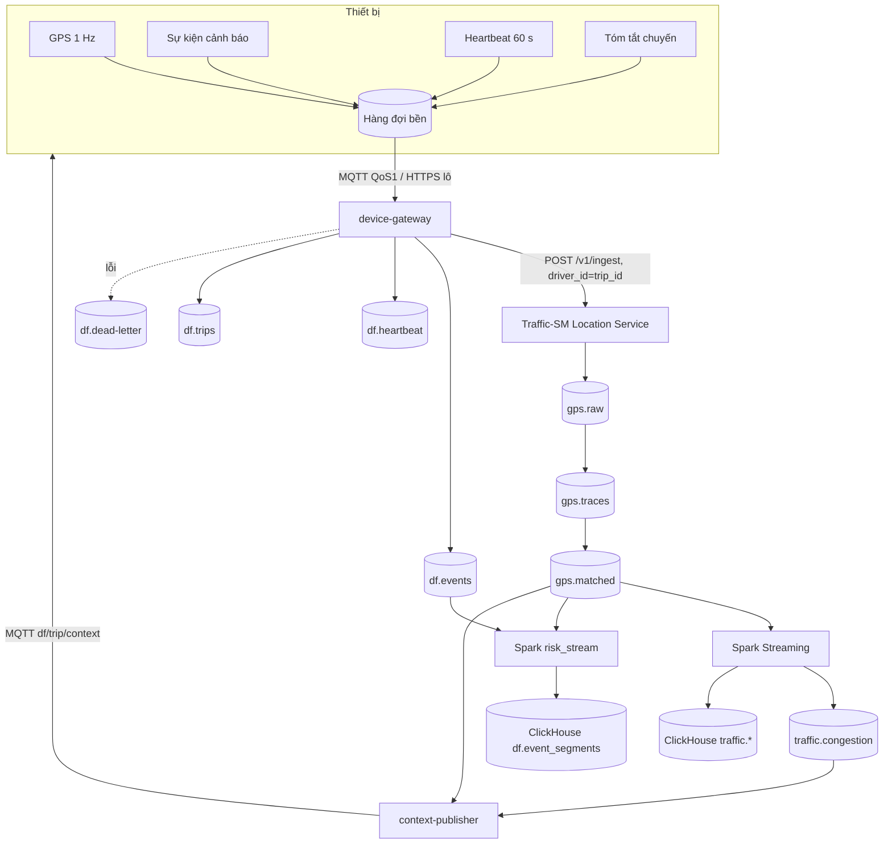

# 5. Luồng dữ liệu và hợp đồng thông điệp

## 5.1 Định danh: ba mã, ba phạm vi

| Mã | Ví dụ | Ai thấy | Dùng để |
|---|---|---|---|
| `device_id` | `df-7f3a...` | Thiết bị, device-gateway, kho ánh xạ, quản trị thiết bị | Xác thực, OTA, heartbeat |
| `trip_id` | UUIDv7, sinh ở thiết bị khi vào trạng thái `MOVING` đầu tiên sau khi bật máy | Mọi nơi trong DF-Cloud và **Traffic-SM** | Gom dữ liệu một chuyến |
| `user_id` | Tài khoản chủ xe (cá nhân) | Chỉ chính chủ xe và vùng hạn chế | Trang cá nhân, điểm lái an toàn |

**Ranh giới ẩn danh:** device-gateway nhận GPS có `device_id`, gửi sang Traffic-SM với `driver_id = trip_id`. Traffic-SM (vốn dùng `driver_id` làm khóa phân vùng Kafka và khóa trạng thái) vẫn chạy nguyên vẹn nhưng không bao giờ thấy `device_id`. Bảng ánh xạ `trip_id → device_id → user_id` nằm riêng trong vùng dữ liệu hạn chế (file 7).

## 5.2 Luồng tổng quát



## 5.3 Thông điệp từ thiết bị

Tất cả là JSON, có `schema` và `seq` tăng đơn điệu theo `device_id` (giúp phát hiện mất tin và loại trùng). Mọi thời điểm là UTC, đo bằng RTC của thiết bị; gateway tính độ lệch đồng hồ khi nhận.

### GPS (khớp định dạng ingest của Traffic-SM)

`POST /v1/ingest` của Location Service nhận một bản ghi hoặc mảng (tối đa 5.000, thân tối đa 8 MB) và kiểm tra rất chặt (`gps.Canonicalize`, đọc từ mã nguồn ngày 09/11/2026):

- Bắt buộc có đủ: `driver_id`, `t_timestamp`, `time`, `status`, `vehicle_type` và các số hữu hạn `lat`, `lng`, `bearing`, `bearing_acc`, `horizontal_acc`, `speed`, `speed_acc`, `time_delta`, `vertical_acc`, `timestamp`, `altitude`.
- `vehicle_type` chỉ nhận **`car` hoặc `bike`** (không phải `motorcycle`); `status` là `IN TRIP`, `ONLINE` hoặc `OFFLINE`.
- `time` theo múi giờ **Asia/Ho_Chi_Minh (UTC+7)**, dạng `M/D/YYYY H:MM` (ví dụ `10/27/2026 8:00`); `t_timestamp` dạng `MM:SS.s` (cắt, không làm tròn, về phần mười giây) và **phút phải trùng với phút của `time`**.
- `bearing` là `-1` (không biết) hoặc `[0, 360)`; các trường độ chính xác và `speed` không âm; `timestamp` là Unix giây, dương.

Thiết bị không phải gửi đủ các trường này. Thiết bị gửi gọn cho **device-gateway** `{ts, lat, lng, speed_mps}` (thêm `bearing`... nếu có), và gateway **điền các trường còn lại, tính hướng đi từ hai điểm liên tiếp, đổi `driver_id` thành `trip_id`, bỏ `device_id`** rồi chuyển tiếp. Lớp chuyển đổi này đã được cài đặt (`cloud/src/drivefocus_cloud/gateway.py`) và đối chiếu với 200 dòng của `traffic-SM/data/gps-fake/fake_gps.csv`: với cùng `timestamp` nó tái tạo đúng `time` và `t_timestamp` của chính Traffic-SM.

Bản ghi mà gateway chuyển tiếp:

```json
{
  "driver_id": "<trip_id>",
  "t_timestamp": "00:00.9", "time": "10/27/2026 8:00", "timestamp": 1793062800.907,
  "lat": 10.775903, "lng": 106.705851,
  "bearing": 311.69, "bearing_acc": 10.0, "horizontal_acc": 5.0,
  "speed": 1.878, "speed_acc": 0.5, "time_delta": 1.0, "vertical_acc": 5.0,
  "altitude": 0.0, "status": "IN TRIP", "vehicle_type": "car"
}
```

`speed` tính bằng m/s. `vehicle_type` lấy từ cấu hình thiết bị (`car` hoặc `bike`); Traffic-SM đã có hai đồ thị tốc độ riêng cho hai loại.

### Sự kiện cảnh báo `df.event.v1`

```json
{
  "schema": "df.event.v1",
  "event_id": "018f...",
  "device_id": "df-7f3a...",
  "trip_id": "018e...",
  "seq": 4021,
  "type": "EYES_CLOSED",
  "level": 4,
  "ts_start": "2026-11-09T14:03:11.200Z",
  "ts_end":   "2026-11-09T14:03:14.700Z",
  "duration_ms": 3500,
  "distance_m": 48.2,
  "speed_kmh_avg": 49.6,
  "speed_kmh_max": 51.0,
  "lat": 10.7769, "lng": 106.7009,
  "confidence": 0.93,
  "eyes_observable": true,
  "context_used": {"speed_limit_kmh": 50, "congestion": "FREE", "age_s": 18},
  "fw_version": "0.3.1",
  "model_version": "effl0-int8-2026.11",
  "config_version": 1
}
```

`type` thuộc: `EYES_CLOSED`, `PERCLOS_HIGH`, `YAWN`, `HEAD_NOD`, `LOOK_AWAY`, `PHONE`, `BEHAVIOR_OTHER`, `NO_FACE`, `CAMERA_OBSTRUCTED`, `PAUSE_PRESSED`, `DEVICE_TAMPER`. `event_id` do thiết bị sinh để gửi lại mà không nhân đôi.

### Heartbeat `df.heartbeat.v1` (60 giây một lần)

```json
{
  "schema": "df.heartbeat.v1", "device_id": "df-7f3a...", "seq": 90211,
  "ts": "2026-11-09T14:04:00Z", "moving_state": "MOVING",
  "fps_face": 14.8, "fps_cls": 4.9, "temp_c": 63.5,
  "face_visible_ratio": 0.97, "eyes_observable_ratio": 0.91,
  "queue_depth": 12, "gps_fix": true, "gps_acc_m": 5.5,
  "fw_version": "0.3.1", "model_version": "effl0-int8-2026.11", "config_version": 1
}
```

### Tóm tắt chuyến `df.trip.v1` (khi kết thúc chuyến)

`trip_id`, `device_id`, thời điểm bắt đầu/kết thúc, quãng đường, thời gian chuyển động, số sự kiện theo `type` × `level`, PERCLOS trung bình, tỉ lệ thời gian mắt quan sát được.

### Ngữ cảnh đường `df.context.v1` (từ đám mây xuống, có hạn dùng)

```json
{
  "schema": "df.context.v1", "trip_id": "018e...",
  "ts": "2026-11-09T14:03:20Z", "valid_for_s": 60,
  "segment_key": 123456789, "road_class": "primary",
  "speed_limit_kmh": 50, "congestion": "SLOW", "speed_ratio": 0.62
}
```

## 5.4 Kênh truyền và chất lượng dịch vụ

| Luồng | Giao thức | Chất lượng | Lý do |
|---|---|---|---|
| Sự kiện, heartbeat, tóm tắt | MQTT 3.1.1/5 qua TLS, QoS 1 | Ít nhất một lần; gateway loại trùng theo `event_id` | Mạng di động chập chờn, gói nhỏ, thiết bị tự kết nối lại |
| GPS | MQTT QoS 0/1 hoặc HTTPS lô qua API gateway | Mất vài điểm chấp nhận được (Traffic-SM chịu được) | Dữ liệu thô dày |
| Ngữ cảnh xuống | MQTT, topic `df/{device_id}/context` | QoS 0, có `valid_for_s` | Không cần giữ, chỉ cần mới |
| Cấu hình, OTA | HTTPS có chữ ký + MQTT báo có bản mới | Thiết bị tự kéo về | Thiết bị chủ động, không mở cổng nhận |

Quy ước topic MQTT: thiết bị chỉ **ghi** vào `df/{device_id}/up/#` và chỉ **đọc** `df/{device_id}/down/#`, với `{device_id}` bị buộc bằng chứng chỉ (file 7).

## 5.5 Topic Kafka

Mới (tiền tố `df.`), tạo cùng cách `kafka-init` của Traffic-SM (8 partition, khóa là `device_id` hoặc `trip_id` để giữ thứ tự):

| Topic | Khóa | Nội dung | Thời gian giữ gợi ý |
|---|---|---|---|
| `df.events` | `device_id` | Sự kiện cảnh báo | 7 ngày |
| `df.heartbeat` | `device_id` | Nhịp sống | 24 giờ |
| `df.trips` | `device_id` | Tóm tắt chuyến | 7 ngày |
| `df.dead-letter` | | Tin lỗi định dạng/chữ ký | 14 ngày |

Dùng lại từ Traffic-SM, không đổi: `gps.raw`, `gps.traces`, `gps.matched`, `gps.dead-letter`, `traffic.congestion`.

## 5.6 Bảng ClickHouse (cơ sở dữ liệu `df`)

Theo cùng phong cách bảng của `clickhouse/init.sql` trong Traffic-SM (`ReplacingMergeTree` để xử lý gửi lại, phân vùng theo ngày).

| Bảng | Khóa sắp xếp | Ghi chú |
|---|---|---|
| `df.events` | (`trip_id`, `ts_start`, `event_id`) | Sự kiện thô. Không chứa `device_id`; chứa `trip_id`. |
| `df.trips` | (`trip_id`) | Tóm tắt chuyến, không có `device_id` |
| `df.device_health` | (`device_id`, `ts`) | Heartbeat. Ở vùng quản trị thiết bị |
| `df.event_segments` | (`graph_version`, `traversal_key`, `ts_start`) | Sự kiện đã khớp đoạn đường (`risk_stream` ghi). Không có định danh |
| `df.risk_segment_hour` | (`graph_version`, `traversal_key`, `hour_of_week`) | Số sự kiện theo mức/loại trên số giờ-xe đi qua đoạn đó (tỉ lệ rủi ro). Bảng tổng hợp cho bản đồ rủi ro |
| `df.trip_owner` | (`trip_id`) | Ánh xạ `trip_id → device_id → driver_ref`, **vùng hạn chế**, cột mã hóa, TTL ngắn |

Chỉ số rủi ro (cần mẫu đủ lớn mới có ý nghĩa): `rủi_ro(đoạn, giờ) = số_sự_kiện_mức≥2 / số_giờ_xe_đi_qua`, với mẫu số lấy từ `gps.matched` (đã có trong Traffic-SM). Tránh nhầm "đoạn nhiều xe nên nhiều sự kiện" thành "đoạn nguy hiểm".

## 5.7 Khớp sự kiện vào đoạn đường

Traffic-SM đã gắn mỗi điểm GPS vào đoạn đường (`traversal_key`) trong `gps.matched`. Do `driver_id` ở đó chính là `trip_id`, job Spark `risk_stream` thực hiện:

1. Đọc `df.events` và `gps.matched`.
2. Nối luồng-luồng theo `trip_id` và điều kiện thời gian: điểm `matched` gần nhất trong ±3 giây quanh thời điểm đỉnh của sự kiện, có watermark (cùng cách Spark streaming đã dùng ở Traffic-SM).
3. Ghi sự kiện kèm `traversal_key` vào `df.event_segments`; cập nhật `df.risk_segment_hour`.

Sự kiện đến muộn (thiết bị offline) vẫn khớp được nếu `gps.matched` còn trong data lake: có một đường batch ban đêm nối lại phần đã trễ quá watermark. Đây là mô hình Lambda giống Traffic-SM.

## 5.8 Giao diện lập trình (API)

> Xác thực, mTLS và giới hạn tốc độ nói trong mục này được làm ở P6; trước đó API chạy nội bộ không xác thực.

| API | Người dùng | Ghi chú |
|---|---|---|
| `POST /v1/device/enroll` | Thiết bị lần đầu | Trao đổi CSR + mã kích hoạt một lần lấy chứng chỉ (file 7) |
| `GET /v1/device/config` | Thiết bị | Cấu hình ký số theo `config_version` |
| `GET /v1/device/update` | Thiết bị | Metadata gói OTA có chữ ký |
| `GET /v1/me/trips`, `/v1/me/events` | Chủ xe | Chỉ dữ liệu của chính mình |
| `GET /v1/risk/segments` | Phân tích | Dữ liệu tổng hợp, không định danh |
| `GET /v1/context?trip=...` | Nội bộ/gỡ lỗi | Ngữ cảnh gần nhất (thiết bị dùng kênh đẩy MQTT, không dùng API này) |

API công khai ra ngoài đi qua API gateway có xác thực, giới hạn tốc độ và xác thực đầu vào (file 7).
