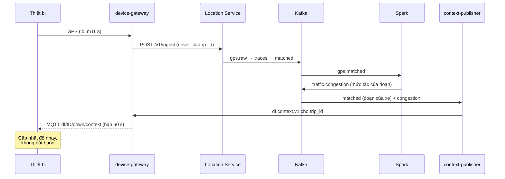

# 6. Tích hợp Traffic-SM và dds-edge

Mục tiêu: dùng lại tối đa, sửa tối thiểu hai repo hiện có. Tài liệu này liệt kê rõ cái gì giữ nguyên, cái gì thêm, cái gì phải sửa.

## 6.1 Từ dds-edge: dùng gì và không dùng gì

**Quyết định:** các quyết định quan trọng (nhắm mắt, buồn ngủ, nhìn lệch, điện thoại) dùng **thuật toán** của DriveFocus (file 4), **không** dùng mô hình phân loại EfficientNet/MobileNet/ResNet đã huấn luyện trong `dds-edge`.

### Dùng lại từ dds-edge

| Thành phần | Dùng thế nào |
|---|---|
| Dữ liệu State Farm và `data/processed/manifest.csv` (chia theo tài xế) | Một **nguồn dữ liệu đánh giá** cho luật hình học bàn tay–khuôn mặt (lớp gọi/nhắn điện thoại, uống nước). Chỉ là một phần trong nhiều nguồn (file 4, 4.8) |
| Mô hình EfficientNet-Lite0 (`models/effl0_f10`) | **Kênh phụ tùy chọn, ngoài đường quyết định**: đối chiếu offline với luật hình học, minh họa trong báo cáo |
| Mã đo đạc: ONNX, ONNX Runtime, đo độ trễ | Dùng lại để đo mô hình cảm biến trên PC; khung bảng đo `reports/summary.md` làm mẫu bảng đo K230 |
| `web_demo.py` | Cơ sở cho giao diện bản giả lập (xem ảnh camera, mức cảnh báo ảo) |
| Kinh nghiệm: chia tập theo tài xế, không lật ngang ảnh | Giữ nguyên khi đánh giá |

### Không dùng

| Điều | Vì sao |
|---|---|
| Mô hình phân loại làm bộ phát hiện nhắm mắt/buồn ngủ | State Farm không có lớp này; yêu cầu của đồ án là dùng thuật toán |
| Số F1 State Farm làm thước đo chất lượng cuối | Khác miền (góc ghế phụ, ban ngày); chỉ là một nguồn bổ trợ |

### Việc thêm vào phía dds-edge

1. Tập lệnh chạy luật hình học bàn tay–khuôn mặt trên ảnh State Farm để lấy precision/recall (đối chiếu với bộ phân loại cũ).
2. Thư mục dữ liệu tự quay có đồng ý (`data/own_recordings`), thêm nhãn thời lượng nhắm mắt.

## 6.2 Từ Traffic-SM: những gì giữ nguyên

| Thành phần | Dùng nguyên |
|---|---|
| Location Service `POST /v1/ingest` (nhận 1 bản ghi hoặc mảng đến 5.000) | Điểm vào GPS. Thiết bị không gọi trực tiếp, đi qua device-gateway |
| Trace builder → map matcher → `gps.matched` | Không đổi |
| GraphHopper, Tile38 | Không đổi |
| Spark `congestion_stream.py`, `baseline_batch.py` | Không đổi |
| ClickHouse `traffic.*`, Grafana dashboard tắc nghẽn | Không đổi |
| `gps-simulator`, `gps-replayer` | Nguồn xe nền (traffic nền) để thử nghiệm ghép |

Xe DriveFocus chỉ là **một trong nhiều nguồn** vào cùng pipeline. Với Traffic-SM, một thiết bị thật trông giống một tài xế giả lập với vài tính chất khác (nhiễu GPS thật, mất tin thật). Đây là điểm kiểm tra tốt cho tính chịu lỗi của nó.

## 6.3 Từ Traffic-SM: những gì phải thêm hoặc sửa

> Trạng thái cài đặt (09/11/2026): gateway ẩn danh hóa và chuyển tiếp GPS đã làm và kiểm thử với **ingest giả lập** theo đúng quy tắc của Go. **Chưa chạy với Traffic-SM thật** (cần Docker, Go và dữ liệu OSM). Các mục T3 đến T8 chưa làm.

| # | Việc | Loại | Vì sao |
|---|---|---|---|
| T1 (P6) | Đặt xác thực và giới hạn tốc độ **trước** `/v1/ingest` và `/locations` (qua API gateway) | Sửa cấu hình / thêm dịch vụ | Hiện cổng này không có xác thực |
| T2 (P6) | Bỏ công bố cổng ra máy chủ cho Kafka, ClickHouse, Spark UI, Tile38, GraphHopper; bật SASL_SSL và ACL cho Kafka | Sửa `docker-compose.yml` | Hiện Kafka dùng PLAINTEXT, nhiều cổng công khai, Grafana cho xem ẩn danh, mật khẩu mặc định (`admin/admin`, `traffic/traffic`) |
| T3 | `risk_stream.py` (Spark): khớp `df.events` với `gps.matched` | Thêm job mới | Không sửa job cũ |
| T4 | `context-publisher`: đọc `gps.matched` + `traffic.congestion` + `max_speed`/loại đường, gửi MQTT cho từng chuyến | Thêm dịch vụ mới | Phản hồi ngữ cảnh cho thiết bị |
| T5 | Xuất thêm loại đường và giới hạn tốc độ của đoạn vào `gps.matched` hoặc bảng tra | Thêm trường | GraphHopper đã có thông tin `max_speed`; cần xác nhận cách đưa ra |
| T6 | Bảng `traffic.latest_congestion` đã có; thêm cách truy vấn theo `traversal_key` nhanh | Dùng nguyên hoặc thêm chỉ mục | Phục vụ `context-publisher` |
| T7 (P6) | Lưu `gps.matched` ở data lake kèm `driver_id` (đang là `trip_id`) với chính sách xóa/ẩn danh hóa sau N ngày | Cấu hình | Giảm tồn tại dữ liệu đi lại |
| T8 | Dashboard Grafana mới cho bản đồ rủi ro và sức khỏe thiết bị | Thêm | |

Giới hạn hiện có của Traffic-SM cần ghi nhớ khi ghép (theo README của nó):
- Trạng thái trong Location Service chỉ nằm RAM, `/map` chưa tô màu đường theo Spark. Không ảnh hưởng thiết kế này vì ta dùng ClickHouse và `traffic.congestion`.
- Map matching là điểm nghẽn ở khoảng 3.000 sự kiện/giây trên một bản sao; ở khoảng 1.000 tài xế thì độ trễ vẫn khoảng 11 giây. Mục tiêu demo (vài chục đến vài trăm thiết bị thật + traffic nền mô phỏng) nằm trong vùng ổn định.
- Replayer chế độ lặp làm tài xế "nhảy vị trí", trace dính điểm nhảy vào dead-letter. Đừng dùng `--loop` khi thử ghép.

## 6.4 Giá trị của việc ghép: ba trường hợp dùng

### (a) Đội xe là mạng cảm biến giao thông

Mỗi xe DriveFocus gửi GPS vào Traffic-SM nên đóng góp vào mức tắc nghẽn và tốc độ chuẩn theo đoạn đường × giờ. Traffic-SM không phân biệt nguồn là xe mô phỏng hay xe thật.

### (b) Bản đồ rủi ro

`risk_stream` gắn sự kiện nguy hiểm vào đoạn đường, rồi chia cho lưu lượng xe đi qua đoạn đó trong cùng khung giờ (lấy từ `gps.matched`). Trả lời được câu hỏi như: "Đoạn nào, khung giờ nào, tài xế hay nhắm mắt hoặc dùng điện thoại nhiều nhất?" (tổng hợp, không cần danh tính). Người dùng: chủ xe (chọn tuyến, nghỉ giải lao), người xem bản đồ rủi ro.

### (c) Ngữ cảnh đường cho cảnh báo thông minh hơn

Đây là chỗ Traffic-SM hữu ích hơn "kiểm tra GPS một xe":



Độ trễ vòng này khoảng 10 đến 60 giây, đủ dùng cho ngữ cảnh chậm thay đổi (giới hạn tốc độ, loại đường, tắc đường) nhưng **không** dùng cho quyết định tức thời. Vì vậy ngữ cảnh chỉ điều chỉnh mức (xem bảng ở file 4), không bao giờ là điều kiện cần của cảnh báo.

Hướng mở rộng sau (ngoài phạm vi hiện tại): cảnh báo trước tắc nghẽn phía trước ("sắp có đoạn CONGESTED cách 500 m") nhờ mức tắc của các đoạn kế tiếp.

## 6.5 Sửa gì ở thư mục hiện có và gì tạo mới

Khi sang giai đoạn viết code, đề xuất bố cục (đặt trong thư mục `drivefocus/`, giữ hai repo cũ gần như nguyên vẹn):

```
drivefocus/
  docs/hld/                  (tài liệu này)
  contracts/                 JSON Schema/Protobuf của df.* và df.context
  edge/
    core/                    lõi thuật toán (Python tham chiếu, C++ cho K230)
    hal-sim/                 webcam/video, GPX, âm thanh ảo
    hal-k230/                MIPI, UART, I2C, PWM, I2S
    models/                  .onnx và .kmodel đã ký, kèm model card
    golden/                  golden traces
  cloud/
    device-gateway/          Go: MQTT/HTTPS → ẩn danh hóa → Kafka/ingest
    context-publisher/       Go
    spark/risk_stream.py     Spark
    clickhouse/df.sql
    deploy/                  Compose (và về sau Kubernetes), mTLS, Keycloak, CA
  ../dds-edge/               giữ nguyên, thêm gói k230
  ../traffic-SM/             giữ nguyên, sửa T1, T2, T5; mọi thứ khác là thêm
```

Hai repo cũ tiếp tục là repo git độc lập; `drivefocus` tham chiếu chúng bằng submodule hoặc bằng việc nằm cạnh nhau (chốt ở câu hỏi mở trong file 10).
