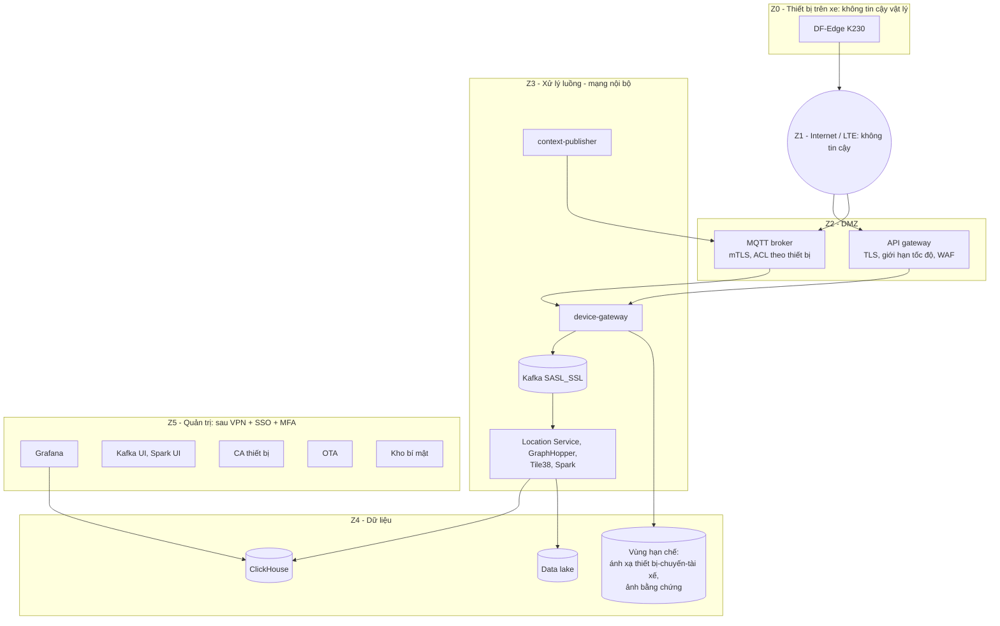

# 7. Bảo mật và riêng tư

> **Trạng thái: làm sau cùng (P6).** Theo yêu cầu của nhóm, bảo mật không chặn tiến độ các phần thuật toán, thiết bị và tích hợp. Tài liệu này là thiết kế tham chiếu để triển khai khi có thời gian, và để báo cáo có mục hướng phát triển về bảo mật. Hai việc **rẻ và nên giữ ngay từ đầu** vì ảnh hưởng thiết kế dữ liệu: (1) video không rời thiết bị, (2) Traffic-SM chỉ thấy `trip_id` ẩn danh. Mọi mục đánh dấu **[demo]** bên dưới dời sang P6.

Phần này làm trước các phần khác theo yêu cầu: chốt vùng, danh tính, phân quyền, dữ liệu cá nhân **trước khi** nối hai hệ thống. Mức chi tiết là thiết kế; demo triển khai các điểm đánh dấu **[demo]**, phần còn lại là yêu cầu cho giai đoạn pilot.

## 7.1 Hiện trạng cần sửa trước khi ghép

Theo README và `docker-compose.yml` của Traffic-SM, hệ thống hiện được thiết kế để chạy một máy khi phát triển:

| Hiện trạng | Rủi ro | Xử lý |
|---|---|---|
| Kafka dùng listener `PLAINTEXT`, không xác thực | Ai vào được mạng đều đọc/ghi mọi topic | SASL_SSL (hoặc mTLS) + ACL theo từng dịch vụ **[demo]** |
| Hầu hết cổng publish ra máy chủ (8080, 8081, 8082, 8090, 3000, 4040, 8123, 9851, 8989) | Lộ bảng điều khiển và dữ liệu | Chỉ cổng qua API gateway được công bố; còn lại ở mạng nội bộ **[demo]** |
| Grafana cho xem ẩn danh, tài khoản `admin/admin` | Lộ dữ liệu, chiếm quyền | Tắt ẩn danh, SSO, mật khẩu từ kho bí mật **[demo]** |
| ClickHouse `traffic/traffic` | Mật khẩu mặc định | Tài khoản theo dịch vụ, quyền tối thiểu **[demo]** |
| `/v1/ingest` và `/locations` không xác thực, không giới hạn tốc độ | Giả mạo, làm ngập | Đặt sau device-gateway + API gateway **[demo]** |
| Kafka UI, Spark UI, simulator API (`:8090` đổi số tài xế, tạo sự cố) mở | Điều khiển trái phép | Vùng quản trị sau VPN/SSO; tắt simulator ở môi trường có dữ liệu thật |

## 7.2 Phân vùng mạng

Quy tắc luồng giữa các vùng (mặc định từ chối, chỉ mở rõ ràng):

| Từ → Đến | Cho phép |
|---|---|
| Z1 → Z2 | HTTPS/MQTTS cổng công khai duy nhất |
| Z2 → Z3 | Chỉ tới device-gateway |
| Z3 → Z4 | Dịch vụ cụ thể tới cơ sở dữ liệu cụ thể, tài khoản riêng |
| Z5 → mọi vùng | Qua bastion/VPN, ghi nhật ký phiên |
| Z4 → ra ngoài | Cấm |
| Z3 → Z1 | Cấm (trừ cập nhật phụ thuộc qua proxy khi build) |

## 7.3 Tài sản cần bảo vệ

| Tài sản | Phân loại | Ghi chú |
|---|---|---|
| Video/ảnh khuôn mặt | **Rất nhạy cảm** | Không rời thiết bị. Ảnh bằng chứng mặc định tắt |
| Ánh xạ thiết bị ↔ chuyến ↔ tài xế | Nhạy cảm (D3) | Chìa khóa de-anonymize; vùng hạn chế |
| Quỹ đạo GPS | Nhạy cảm (D2 khi gắn `trip_id`, D3 nếu liên kết được tài xế) | Nơi ở, thói quen đi lại suy ra được |
| Điểm lái an toàn theo tài xế | Nhạy cảm (D3) | Ảnh hưởng việc làm, cần quy tắc sử dụng |
| Sự kiện, heartbeat | D2 | |
| Dữ liệu tổng hợp theo đoạn đường | D1 (nội bộ), có thể công bố sau khi kiểm tra k-ẩn danh | Bản đồ tắc nghẽn, bản đồ rủi ro |
| Khóa thiết bị, khóa ký OTA, khóa CA | Tối mật | HSM/kho bí mật; khóa ký OTA ngoại tuyến |
| Mô hình, tham số cấu hình | Sở hữu trí tuệ | Ký để chống thay thế, mã hóa nếu cần |

Phân loại D0 (công khai), D1 (nội bộ), D2 (ẩn danh theo chuyến), D3 (liên kết được người), D4 (sinh trắc/hình ảnh).

## 7.4 Danh tính và xác thực

### Thiết bị

1. **Khóa sinh trên thiết bị.** Cặp khóa sinh bằng bộ sinh số ngẫu nhiên phần cứng (K230 có TRNG, OTP, PUF theo brief); khóa riêng không rời thiết bị.
2. **Đăng ký (enroll) một lần.** Nhà máy/quản trị in mã kích hoạt dùng một lần; thiết bị gửi CSR + mã tới `POST /v1/device/enroll`; CA riêng (ví dụ step-ca) cấp chứng chỉ X.509 có `CN = device_id`.
3. **mTLS mọi kết nối.** Chứng chỉ ngắn hạn (đề xuất 90 ngày) tự gia hạn trước hạn; danh sách thu hồi hoặc OCSP; thu hồi một thiết bị là mất ngay quyền ghi.
4. **Ràng buộc danh tính vào đường đi:** broker rút `device_id` từ chứng chỉ, ACL chỉ cho ghi `df/{device_id}/up/#` và đọc `df/{device_id}/down/#`. Thiết bị không thể mạo danh thiết bị khác, kể cả khi bị hack.
5. **Cấm mật khẩu mặc định, cổng quản trị trên thiết bị.** Không SSH mở, không UART shell trên bản phát hành; thiết bị không lắng nghe cổng nào (chủ động gọi ra).

Ghi chú: brief K230 **không nêu secure boot và TEE**. Nếu chip/SDK không hỗ trợ secure boot ở mức mask ROM, thiết kế hạ xuống: bootloader tự kiểm chữ ký ứng dụng + khóa xác minh đặt ở OTP + cầu chì vô hiệu hóa debug. Cần đối chiếu datasheet đầy đủ trước khi cam kết.

### Con người

| Đối tượng | Cơ chế |
|---|---|
| Chủ xe, nhóm quản trị, người xem bản đồ rủi ro | OIDC qua IdP (ví dụ Keycloak) + MFA; phiên ngắn |
| Dịch vụ với dịch vụ | mTLS nội bộ hoặc SASL/SCRAM; bí mật từ kho bí mật, không nằm trong repo hay file Compose |
| Tài xế xem dữ liệu của mình | Đăng nhập OIDC, chỉ thấy bản ghi liên kết với `driver_ref` của mình |

## 7.5 Mô hình đe dọa (STRIDE rút gọn)

| Đe dọa | Ví dụ | Biện pháp |
|---|---|---|
| **S**poofing | Giả thiết bị gửi sự kiện/GPS giả | Chứng chỉ thiết bị, ACL theo `device_id`, kiểm tra hợp lý (tốc độ bất khả thi, vị trí nhảy) |
| **S**poofing | Giả GPS trên xe (GPS spoof) | Đối chiếu GPS với IMU, độ chính xác báo cáo; cờ nghi vấn không chặn, chỉ giảm tin cậy |
| **T**ampering | Sửa firmware/mô hình để tắt cảnh báo | Ký số firmware và mô hình, bootloader kiểm tra, A/B và rollback |
| **T**ampering | Che/tháo camera | Phát hiện `NO_FACE`/`CAMERA_OBSTRUCTED`, `DEVICE_TAMPER` (nguồn rút khi ACC bật), báo chủ xe |
| **R**epudiation | Chủ xe chối sự kiện; quản trị viên sửa dữ liệu | `event_id`, `seq` tăng đơn điệu, nhật ký truy cập bất biến (WORM), phiên bản cấu hình ghi trong sự kiện |
| **I**nformation disclosure | Lộ quỹ đạo, lộ ánh xạ tài xế | Ẩn danh `trip_id`, tách vùng hạn chế, mã hóa lưu trữ và đường truyền, quyền theo vai trò |
| **I**nformation disclosure | Trộm thiết bị đọc dữ liệu | Hàng đợi cục bộ chỉ chứa số liệu, mã hóa khối bằng khóa thiết bị; không có ảnh |
| **D**enial of service | Làm ngập cổng ingest | API gateway: giới hạn tốc độ theo chứng chỉ, kích thước thân yêu cầu, hạn mức lô (ingest hiện cho 8 MB/5.000 bản ghi) |
| **D**enial of service | Báo nhầm hàng loạt để tài xế tắt thiết bị | Không phải tấn công mạng nhưng là rủi ro vận hành (file 8: hiệu chỉnh theo dữ liệu) |
| **E**levation of privilege | Dịch vụ bị chiếm dùng Kafka ngoài vai trò | ACL Kafka theo dịch vụ, quyền ClickHouse tối thiểu, không chạy container bằng root |
| Chuỗi cung ứng | Gói/phụ thuộc độc hại, ảnh container giả | Ghim phiên bản, quét ảnh, SBOM, kiểm tra chữ ký (file 9) |

An toàn chức năng đáng chú ý: **lỗi của thiết bị không được làm hại thêm.** Mức 4 phải có giới hạn âm lượng và thời gian tối đa hợp lý, có watchdog để thiết bị tự khởi động lại, không điều khiển xe.

## 7.6 Phân quyền (RBAC)

| Vai trò | Thấy | Không thấy |
|---|---|---|
| `device` | Chỉ topic của chính nó | Mọi thứ khác |
| `gateway-svc` | Ghi `df.*`, `gps.raw` (qua ingest); đọc ánh xạ | Dữ liệu phân tích |
| `stream-svc` (Spark, Location Service) | Đọc/ghi các topic của nó; ghi bảng của nó | Ánh xạ thiết bị-tài xế |
| `context-svc` | Đọc `gps.matched`, `traffic.congestion`; ghi MQTT `down/context` | Sự kiện chi tiết |
| `analyst` | Bảng tổng hợp theo đoạn đường | `device_id`, `driver_ref`, quỹ đạo thô |
| `owner` | Chuyến, sự kiện và điểm lái an toàn của **chính mình** | Dữ liệu người khác |
| `driver` | Dữ liệu của chính mình; yêu cầu xóa | Người khác |
| `ops-admin` | Cấu hình hệ thống, thiết bị, trạng thái | Nội dung dữ liệu cá nhân (tách quyền: quản trị hệ thống ≠ xem dữ liệu) |
| `security-auditor` | Nhật ký truy cập, cấu hình | Không sửa |

Truy cập vùng hạn chế (ánh xạ, ảnh bằng chứng) cần phê duyệt hai người (4-eyes) và để lại nhật ký.

## 7.7 Mã hóa và bí mật

| Lớp | Biện pháp |
|---|---|
| Truyền | TLS 1.2+ (ưu tiên 1.3); mTLS cho thiết bị và dịch vụ nội bộ |
| Lưu (đám mây) | Mã hóa đĩa/volume; cột nhạy cảm của vùng hạn chế mã hóa riêng |
| Lưu (thiết bị) | Hàng đợi mã hóa bằng khóa thiết bị |
| Bí mật | Kho bí mật (ví dụ OpenBao/Vault hoặc SOPS cho demo); không đưa vào Git hay biến môi trường trong Compose cho môi trường có dữ liệu thật |
| Khóa ký OTA | Giữ ngoại tuyến hoặc HSM; ký trong quy trình CI có phê duyệt |
| Xoay vòng | Chứng chỉ thiết bị 90 ngày, chứng chỉ dịch vụ ngắn hạn, mật khẩu theo kho bí mật |

## 7.8 Riêng tư theo thiết kế

1. **Giảm thu thập từ gốc.** Video, ảnh, vector khuôn mặt không rời thiết bị. Không làm nhận dạng danh tính khuôn mặt.
2. **Ẩn danh hóa tại cổng.** Traffic-SM và `df.events` chỉ có `trip_id`. Ánh xạ nằm riêng, có TTL.
3. **Giảm độ chính xác khi tổng hợp.** Bản đồ rủi ro công bố theo đoạn × giờ-trong-tuần, không dưới ngưỡng tối thiểu số chuyến khác nhau (đề xuất ≥ 5) để tránh suy ngược một cá nhân.
4. **Ảnh bằng chứng:** mặc định tắt. Nếu bật (có thỏa thuận riêng với tài xế), chỉ chụp tại sự kiện mức 4, mã hóa tại thiết bị, TTL ngắn (đề xuất 7 ngày), truy cập 4-eyes.
5. **Minh bạch.** Đèn báo camera đang hoạt động, tài liệu nói rõ gì được thu, lưu bao lâu, ai xem.
6. **Mục đích hạn chế.** Dữ liệu an toàn lái xe không dùng để kỷ luật tự động; điểm lái an toàn chỉ hiển thị cho chính chủ xe.

### Chính sách lưu giữ (đề xuất)

| Dữ liệu | Thời gian | Sau đó |
|---|---|---|
| Hàng đợi sự kiện trên thiết bị | Đến khi gửi được, tối đa 24 giờ liên tục offline là dung lượng thiết kế | Ghi đè vòng |
| `gps.matched` ở data lake (kèm `trip_id`) | 30 đến 90 ngày | Xóa `trip_id`, giữ lại bản tổng hợp theo đoạn × giờ |
| `df.events`, `df.trips` | 12 tháng | Xóa hoặc tổng hợp |
| Ánh xạ `trip_owner` | 90 ngày hoặc theo hợp đồng | Xóa = các chuyến cũ không còn truy ngược được (crypto-shredding nếu mã hóa bằng khóa theo tháng) |
| Ảnh bằng chứng | 7 ngày | Xóa |
| Nhật ký truy cập/kiểm toán | 12 đến 24 tháng, bất biến | |

### Quyền của chủ thể dữ liệu

Truy cập, sửa, xóa, rút lại đồng ý. Thực thi xóa: gỡ hàng khỏi `df.trip_owner` (làm các chuyến cũ không liên kết được) và xóa dữ liệu liên kết ở vùng hạn chế; các bản tổng hợp đã không định danh thì giữ.

## 7.9 Pháp lý (cần xác nhận với tư vấn pháp lý)

Tài liệu này không phải tư vấn pháp lý. Những điểm cần kiểm tra khi tiến tới triển khai thật:

- **Nghị định 13/2023/NĐ-CP** về bảo vệ dữ liệu cá nhân (Việt Nam): dữ liệu vị trí và đặc điểm sinh học thuộc nhóm nhạy cảm; cần đồng ý rõ ràng, đánh giá tác động xử lý dữ liệu, thông báo mục đích.
- **Luật Bảo vệ dữ liệu cá nhân** được Quốc hội thông qua năm 2025 (hiệu lực dự kiến từ 01/01/2026): cần xác nhận văn bản và hướng dẫn hiện hành.
- Với người dùng cá nhân, cần đồng ý rõ ràng của chủ xe và của người ngồi ghế lái nếu khác chủ xe.
- Tham chiếu quốc tế để tham khảo hiệu năng, không bắt buộc ở Việt Nam: các quy định giám sát buồn ngủ/mất tập trung của tài xế trong khung an toàn xe cơ giới của EU (kiểm tra số hiệu và yêu cầu hiện hành trước khi trích dẫn); GDPR nếu có người dùng ở EU.
- Đây là thiết bị hỗ trợ, không đảm bảo ngăn tai nạn. Cần điều khoản miễn trừ trong tài liệu sản phẩm.

## 7.10 Giám sát an ninh

- Nhật ký tập trung có chữ ký thời gian từ API gateway, MQTT broker, device-gateway, Kafka (audit), ClickHouse (query log).
- Cảnh báo vận hành: thiết bị mới đăng ký bất thường, một chứng chỉ dùng từ nhiều IP, đột biến sự kiện/ GPS từ một thiết bị, thất bại xác thực hàng loạt, truy cập vùng hạn chế.
- Kiểm thử: quét ảnh container và phụ thuộc trong CI, kiểm thử xâm nhập trước pilot, diễn tập thu hồi chứng chỉ.
