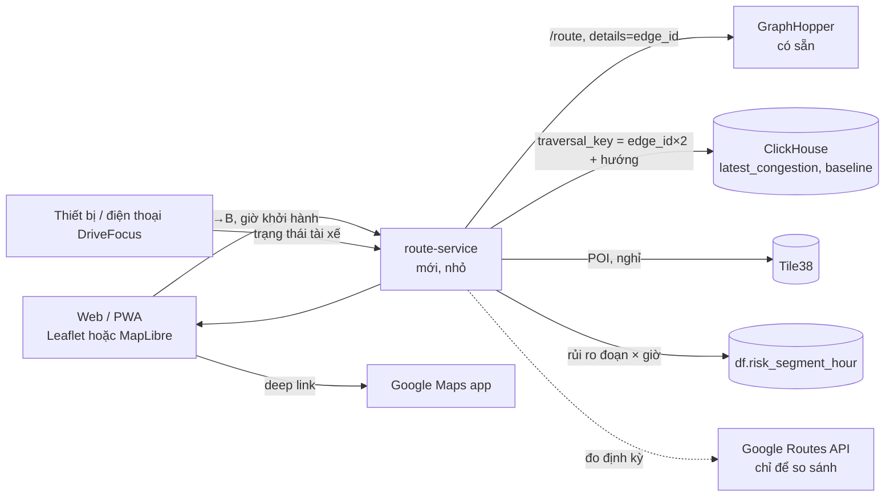

# 13. Web ETA và chỉ đường: tăng giá trị khi phần cứng đắt

> Trạng thái: **đề xuất, chưa cài đặt**. Tôi chưa chạy được Traffic-SM và GraphHopper ở máy phát triển (Docker không chạy), nên mọi điểm "cần kiểm chứng" bên dưới là chưa kiểm chứng.

## 13.1 Vấn đề: K230 cộng AI chỉ để vài tác vụ cảnh báo thì đắt

Đúng. Một thiết bị riêng chỉ để cảnh báo buồn ngủ khó cạnh tranh với ứng dụng điện thoại miễn phí. Có hai cách để giá trị xứng với chi phí, và nên làm cả hai:

1. **Thêm giá trị phần mềm mà thiết bị mở khóa**: một web/ứng dụng về lộ trình và ETA (tài liệu này), dùng chính dữ liệu của Traffic-SM và của DriveFocus.
2. **Hạ rào cản phần cứng**: bản cho điện thoại. Lõi thuật toán (`edge/src/drivefocus`, khoảng 600 dòng Python) là hàm thuần của chuỗi số đo, và đã có bộ **golden trace** chính là để bảo đảm bản cài đặt khác cho cùng kết quả. Một bản TypeScript chạy trên trình duyệt điện thoại (MediaPipe Tasks Vision cho web, Geolocation API) cần đạt đúng golden trace ấy. Như vậy K230 trở thành "bản cao cấp" (chạy liên tục, hồng ngoại ban đêm, không phụ thuộc điện thoại), còn bản điện thoại là bản miễn phí để mở rộng người dùng và thu dữ liệu.

Điều này đảo một quyết định trước đây (D13 trong file 10: không viết ứng dụng điện thoại riêng, để tránh hai bản thuật toán lệch nhau). Lý do đảo là chi phí; rủi ro lệch được giảm bằng golden trace. **Cần bạn xác nhận** trước khi làm.

## 13.2 Nói thẳng: "hơn Google Maps" ở đâu

| Không thể thắng | Vì sao |
|---|---|
| Độ chính xác ETA tổng quát | Google có dữ liệu thăm dò (probe) khổng lồ và mô hình dự báo; Traffic-SM chỉ có xe mô phỏng và vài thiết bị |
| Tìm địa điểm (POI), geocoding, nhập địa chỉ tiếng Việt | Dữ liệu Google dày và sạch hơn OSM rất nhiều |
| Điều hướng từng ngã rẽ, nhận biết làn | Công sức lớn, ngoài phạm vi đồ án |

| Có thể khác biệt hoặc tốt hơn | Vì sao |
|---|---|
| **ETA và tuyến theo trạng thái người lái** | Google không biết bạn đang buồn ngủ. Ví dụ: mệt thì tuyến có trạm nghỉ, ETA đã cộng thời gian nghỉ |
| **Bản đồ rủi ro buồn ngủ, mất tập trung** | Dữ liệu duy nhất mà DriveFocus có và Google không có |
| **ETA theo giờ khởi hành kèm khoảng tin cậy và giải thích** ("đoạn X chậm vì Y xe báo 12 km/h") | Dùng được baseline theo giờ trong tuần mà Traffic-SM đã tính; có thể giải thích, đúng sở trường Big Data |
| **Khu vực đóng** (đội xe nội bộ, khu công nghiệp, trường học) | Nơi Google ít dữ liệu và bạn sở hữu dữ liệu |
| **Dữ liệu và riêng tư do mình kiểm soát** | Không gửi vị trí cho bên thứ ba |

Kết luận trung thực cho báo cáo: **không tuyên bố ETA tốt hơn Google trên toàn thành phố**. Tuyên bố có thể bảo vệ được là: *một hệ thống mở, giải thích được, tích hợp trạng thái người lái, và đo công khai độ lệch so với Google trên một tập cặp điểm đi-đến*.

## 13.3 Kết nối Google Maps: bốn mức, chi phí và ràng buộc tăng dần

Số liệu giá lấy từ ảnh chụp trang giá của Google qua tìm kiếm; **chưa xác nhận trên trang hiện hành**, cần kiểm tra [bảng giá](https://developers.google.com/maps/billing-and-pricing/pricing) trước khi tính toán.

| Mức | Cách | Chi phí | Ràng buộc |
|---|---|---|---|
| **A. Deep link** | Mở `https://www.google.com/maps/dir/?api=1&origin=...&destination=...&waypoints=...&travelmode=driving` để chuyển điều hướng từng ngã rẽ sang ứng dụng Google Maps; waypoint là trạm nghỉ DriveFocus chọn | Miễn phí, không cần khóa (theo tài liệu Maps URLs; chưa kiểm tra lại hôm nay) | Chỉ bàn giao, không lấy dữ liệu về |
| **B. Bản đồ Google + tìm địa điểm** | Maps JavaScript API làm bản đồ nền, Places Autocomplete để nhập địa chỉ; lộ trình và lớp tắc nghẽn của ta vẽ chồng lên | Cần khóa API và tài khoản thanh toán (có thẻ). Bản chụp giá ghi mức miễn phí theo từng SKU, ví dụ 10.000 lần mỗi tháng cho nhóm Essentials | Dữ liệu Places phải hiển thị theo điều khoản của Google; vẽ dữ liệu của mình lên bản đồ Google thì được |
| **C. Google Routes API làm chuẩn so sánh** | Gọi vài trăm lần để so ETA của ta với ETA có tính giao thông của Google | Nhóm "traffic-aware" thuộc SKU đắt hơn, mức miễn phí nhỏ (bản chụp ghi 5.000 lần mỗi tháng; đồ án chỉ cần vài trăm) | **Nội dung Directions không được dùng với bản đồ không phải của Google** (tìm thấy trong điều khoản dịch vụ Maps, bản chưa xác nhận là hiện hành); **bị hạn chế lưu trữ** (tọa độ tối đa 30 ngày). Vì vậy chỉ giữ số liệu thống kê tổng hợp (sai số trung bình), không lưu nguyên phản hồi, và không vẽ tuyến Google lên bản đồ của ta |
| **D. Dùng Google làm backend ETA** | Gọi Routes API cho mọi yêu cầu của người dùng | Tính theo lượt, tăng theo người dùng | Phụ thuộc nhà cung cấp, làm mất ý nghĩa của Traffic-SM. **Không khuyến nghị** |

**Khuyến nghị: bản đồ mở làm lõi + mức A cho điều hướng + mức C để đo.** Mức B chỉ khi bạn muốn nhập địa chỉ tiếng Việt tốt hơn và sẵn sàng có thẻ thanh toán.

**Bản đồ mở:** Traffic-SM đã dùng Leaflet với `tile.openstreetmap.org`. Máy chủ tile công cộng của OSM chỉ phù hợp lưu lượng nhỏ theo chính sách của họ; để demo trước lớp thì ổn, để chạy thật cần nhà cung cấp tile khác. Tìm địa chỉ có thể dùng Nominatim hoặc Photon (chất lượng tiếng Việt chưa kiểm tra).

## 13.4 Kiến trúc đề xuất



**Điều Traffic-SM đã có (đọc từ mã nguồn):** `GET /v1/traffic/states`; `GET /v1/graph-edges` và trang `/map` (Leaflet); GraphHopper trên cổng 8989; bảng ClickHouse `congestion_states`, `baseline_speed` và view `latest_congestion` (mức `FREE|SLOW|CONGESTED|UNKNOWN`, `speed_ratio`, `confidence`, `sample_count`); **`traversal_key = edge_id × 2`, cộng 1 nếu đi ngược chiều** (kiểm tra trong `graph-edge-importer`). **Chưa có:** endpoint lộ trình hoặc ETA, và README ghi rõ `/map` chưa tô màu đường theo dữ liệu Spark.

### ETA ba lớp

1. **Tĩnh**: thời gian GraphHopper trả về (tốc độ theo OSM). Làm mốc.
2. **Trực tiếp**: với mỗi cạnh trên lộ trình, tra `speed_ratio` hiện tại của `traversal_key` tương ứng rồi chia lại thời gian đi cạnh đó.
3. **Dự báo theo giờ khởi hành**: dùng tốc độ điển hình theo (đoạn, giờ trong tuần). Lưu ý `baseline_speed` hiện lưu tốc độ **thông thoáng** (phân vị 85), không phải tốc độ **điển hình**; cần thêm một job Spark batch tính trung vị theo cùng khóa.

Trộn lớp 2 và 3 theo thời điểm xe tới từng đoạn, vì tắc nghẽn ở xa sẽ kịp thay đổi trước khi xe tới:

```
t_cạnh = độ_dài / (v_tham_chiếu × r_hiệu_lực)
r_hiệu_lực = w × r_trực_tiếp + (1 − w) × r_điển_hình(giờ tới)
w = exp(−Δt_tới_đoạn / τ)            τ khởi điểm 10–15 phút, cần hiệu chỉnh
```

Đoạn không có dữ liệu (`UNKNOWN`, `confidence` thấp) thì rơi về tĩnh, và **tỉ lệ đoạn có dữ liệu** quyết định độ rộng của khoảng ETA hiển thị (ví dụ "22–31 phút, dựa trên 64% đoạn đường"). Hiển thị độ tin cậy là điều Google Maps không làm và là điểm trung thực nên có.

### Tránh tắc: xếp hạng lại, chưa định tuyến lại

Định tuyến lại hoàn toàn theo tắc nghẽn cần đổi trọng số theo từng yêu cầu. Cấu hình GraphHopper hiện tại: profile `car` **bật CH** (nhanh nhưng không cho đổi trọng số lúc truy vấn), `profiles_lm` rỗng, profile `motorcycle` không CH. Do đó:

- **Cách đơn giản, khuyến nghị cho đồ án:** xin 2 đến 3 tuyến thay thế, tính ETA lớp 2 và 3 cho từng tuyến, rồi xếp hạng. Không đụng cấu hình GraphHopper. Cần kiểm chứng tuyến thay thế dùng được cùng CH hay phải tắt CH cho yêu cầu đó (`ch.disable=true`).
- **Cách đầy đủ:** custom model theo yêu cầu (vùng `areas` quanh đoạn tắc hoặc rủi ro, hệ số ưu tiên thấp). Phải chạy ở chế độ linh hoạt (không CH) và trên đồ thị cả nước có thể chậm nếu thiếu LM. Cần đo.

### Thách thức kỹ thuật cần giải trước

- **Hướng đi của cạnh.** `details=edge_id` của GraphHopper cho id cạnh nhưng không cho biết xe đi xuôi hay ngược chiều lưu của cạnh. Cần suy ra bằng cách so hình học (đầu và cuối đoạn của lộ trình với hai đầu cạnh), hoặc dùng dữ liệu cạnh đã xuất ở `data/graph-edges/*.geojsonseq`. Đây là phần rủi ro nhất của ETA lớp 2.
- **Độ phủ dữ liệu.** Dữ liệu xe mô phỏng chỉ phủ vùng `SIM_BBOX` (một phần TP.HCM) và chỉ khi simulator chạy.
- **Vòng tròn của việc chấm điểm.** Nếu "thực tế" lấy từ xe mô phỏng thì mô hình tốc độ của simulator vừa tạo dữ liệu vừa là đáp án. Kết quả đó chỉ chứng minh đường ống đúng, không chứng minh độ chính xác ngoài đời.

## 13.5 Tính năng, xếp theo công sức và giá trị

| # | Tính năng | Công sức | Giá trị | Phụ thuộc |
|---|---|---|---|---|
| W1 | Tìm đường A→B, 1 đến 3 tuyến, ETA tĩnh và ETA trực tiếp cạnh nhau | M | Cao (cốt lõi) | Traffic-SM + GraphHopper chạy thật, giải bài toán hướng đi cạnh |
| W2 | Tô màu tắc nghẽn trực tiếp lên bản đồ | S đến M | Cao, trực quan | ClickHouse + `/v1/traffic/states`; sửa hạn chế đã ghi trong README Traffic-SM |
| W3 | **ETA theo giờ khởi hành** (biểu đồ "đi lúc nào thì nhanh nhất") | M | Cao, rất hợp Big Data | Job Spark trung vị theo giờ trong tuần, cần dữ liệu đủ dài |
| W4 | Bàn giao sang Google Maps (deep link) | S | Trung bình, rẻ | Không |
| W5 | Gợi ý trạm nghỉ và tuyến theo trạng thái người lái | M | Cao, **khác biệt** | POI từ OSM vào Tile38; trạng thái từ DriveFocus |
| W6 | Bản đồ rủi ro buồn ngủ | M | Cao, khác biệt | `risk_stream` (chưa làm) |
| W7 | So sánh ETA với Google (đo, không lưu) | S đến M | Cao cho báo cáo | Khóa API, vài trăm lượt gọi; xem ràng buộc mức C |
| W8 | Trang chuyến đi của tôi (sự kiện DriveFocus, điểm lái an toàn) | M | Trung bình | `df.events` (đã có) |

**Gói đề xuất cho đồ án 3** nếu thời gian có hạn: W1 + W2 + W4, thêm W3 hoặc W7 làm điểm nhấn. W5 và W6 là phần khác biệt nhưng phụ thuộc `risk_stream`; có thể để cho đồ án tốt nghiệp cùng nhóm ý tưởng ở file 12.

## 13.6 Đánh giá ETA

| Chỉ số | Cách đo |
|---|---|
| MAE, MAPE, tỉ lệ ETA trong ±20% | So ETA dự báo lúc khởi hành với thời gian thực của xe mô phỏng đi cùng tuyến |
| Ba lớp ETA | Báo cáo riêng tĩnh, trực tiếp và theo giờ để thấy mỗi lớp cải thiện bao nhiêu |
| So với Google | 100 đến 200 cặp đi-đến, ba khung giờ; chỉ ghi lại sai số trung bình, không lưu phản hồi thô |
| Độ phủ | Tỉ lệ cạnh trên tuyến có dữ liệu; vẽ sai số theo độ phủ |

## 13.7 Điều chưa kiểm chứng

- Chưa chạy Traffic-SM, GraphHopper, ClickHouse ở máy phát triển; mọi mô tả về chúng là từ đọc mã nguồn và cấu hình.
- Giá và mức miễn phí của Google lấy từ ảnh chụp trang giá qua tìm kiếm, chưa xác nhận trên trang hiện hành. Điều khoản "không dùng nội dung Directions với bản đồ khác" cũng từ trích đoạn tìm kiếm của nhiều phiên bản điều khoản; phải đọc bản hiện hành trước khi dựa vào.
- Chất lượng geocoding tiếng Việt của Nominatim/Photon chưa đo.
- Chưa có giá thành cụ thể của K230; câu "đắt" ở đầu tài liệu là nhận định của bạn, tôi chưa đối chiếu với bảng giá.
- Chưa kiểm tra tuyến thay thế của GraphHopper hoạt động thế nào với profile CH trong bản fork của bạn.
