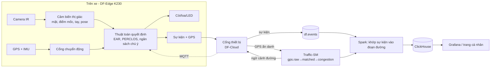

# Tài liệu thiết kế hệ thống (HLD): DriveFocus

DriveFocus là đồ án môn học ghép hai dự án có sẵn:

- **dds-edge**: nhận diện tài xế mất tập trung bằng học sâu trên State Farm. Ở đồ án này chỉ dùng lại dữ liệu, công cụ đo và khung demo; **không dùng mô hình phân loại của nó cho các quyết định quan trọng**.
- **traffic-SM**: nhận GPS của rất nhiều xe, khớp vào đường thật, tính mức tắc nghẽn bằng Kafka + Spark + ClickHouse. Dùng gần như nguyên vẹn.

Phạm vi đã chốt: **ô tô cá nhân**, người dùng cuối là cá nhân, **nhắm mắt liên tục 3 giây là báo động mức 4**, thuật toán là trọng tâm, **bảo mật làm sau cùng**.

| # | File | Trả lời câu hỏi |
|---|---|---|
| 1 | [01-tong-quan-yeu-cau.md](01-tong-quan-yeu-cau.md) | Làm gì, yêu cầu gì, phạm vi tới đâu, rủi ro gì? |
| 2 | [02-kien-truc-tong-the.md](02-kien-truc-tong-the.md) | Các khối lớn, ranh giới thiết bị và đám mây |
| 3 | [03-thiet-bi-bien-k230.md](03-thiet-bi-bien-k230.md) | Chip K230 (6 TOPS), phần cứng, ngân sách tài nguyên, bản giả lập |
| 4 | [04-thuat-toan-va-muc-canh-bao.md](04-thuat-toan-va-muc-canh-bao.md) | **Trọng tâm**: EAR, PERCLOS, ngáp, tư thế, bàn tay–mặt, ngân sách chú ý, cổng chuyển động, 4 mức cảnh báo, đánh giá |
| 5 | [05-luong-du-lieu-va-hop-dong.md](05-luong-du-lieu-va-hop-dong.md) | Thông điệp, topic Kafka, bảng ClickHouse, API |
| 6 | [06-tich-hop-traffic-sm-va-dds-edge.md](06-tich-hop-traffic-sm-va-dds-edge.md) | Dùng gì từ hai repo, sửa gì, ngữ cảnh đường trả về thiết bị |
| 7 | [07-bao-mat-va-rieng-tu.md](07-bao-mat-va-rieng-tu.md) | *(Làm sau cùng, P6)* vùng bảo mật, danh tính, mô hình đe dọa, phân quyền |
| 8 | [08-van-hanh-trien-khai-lo-trinh.md](08-van-hanh-trien-khai-lo-trinh.md) | Môi trường, kiểm thử, giám sát, lộ trình P0 đến P6 |
| 9 | [09-cong-nghe-va-repo.md](09-cong-nghe-va-repo.md) | Công nghệ, repo, giấy phép |
| 10 | [10-hoi-dap-quyet-dinh-va-thuat-ngu.md](10-hoi-dap-quyet-dinh-va-thuat-ngu.md) | Nhật ký quyết định, câu hỏi mở, thuật ngữ |
| 11 | [11-khao-sat-repo-tham-khao.md](11-khao-sat-repo-tham-khao.md) | **Khảo sát repo thật** (openpilot, e-candeloro, SDK K230...) và bộ dữ liệu |
| 12 | [12-y-tuong-mo-rong.md](12-y-tuong-mo-rong.md) | **Ý tưởng mở rộng** vượt cảnh báo: copilot có rào chắn, lệnh theo ánh nhìn, CARLA, trạm nghỉ, cảnh báo cộng đồng |
| 13 | [13-web-eta-dan-duong.md](13-web-eta-dan-duong.md) | **Web ETA và chỉ đường** trên Traffic-SM, kết nối Google Maps, bản cho điện thoại để giảm chi phí phần cứng |

## Hiểu hệ thống trong 5 phút

1. **Trên xe.** Thiết bị K230 gắn camera (hồng ngoại) hướng vào tài xế, thêm GPS và IMU. Mỗi khung hình qua các cảm biến thị giác phổ thông (tìm mặt, điểm mốc, bàn tay, tư thế đầu), cho ra số đo: độ mở mắt (EAR), độ mở miệng (MAR), góc đầu, hướng nhìn, vị trí tay so với mặt.
2. **Thuật toán tự viết đưa ra quyết định.** Bộ đo nhắm mắt (kèm PERCLOS trượt), ngáp, gục đầu, "ngân sách chú ý" cho nhìn lệch và điện thoại, luật hình học bàn tay–mặt. Quan sát ba trạng thái: không nhìn thấy mắt thì ghi `KHÔNG BIẾT`, không suy ra nhắm mắt.
3. **Chỉ khi xe chạy.** Cổng chuyển động đọc tốc độ GPS (ngưỡng 10 km/h, có hysteresis), IMU dự phòng.
4. **Bốn mức cảnh báo.** Nhắc nhẹ → Cảnh báo → Nguy hiểm → **Báo động khẩn cấp**. Nhắm mắt liên tục 3 giây là mức 4; các mức thấp hơn chỉ nhắc để tài xế tự điều chỉnh.
5. **Lên đám mây.** Thiết bị gửi GPS mỗi giây (vào pipeline Traffic-SM dưới mã chuyến ẩn danh) và sự kiện cảnh báo (vào kho sự kiện). Không có video.
6. **Traffic-SM làm hai việc.** (a) Gom GPS nhiều xe thành bản đồ tắc nghẽn. (b) Khớp sự kiện nguy hiểm vào đoạn đường để tạo bản đồ rủi ro theo đoạn × giờ.
7. **Vòng phản hồi.** Đám mây đẩy ngược ngữ cảnh đường (giới hạn tốc độ, loại đường, mức tắc) để chỉnh độ nhạy. Thiếu ngữ cảnh thì thiết bị vẫn chạy.

